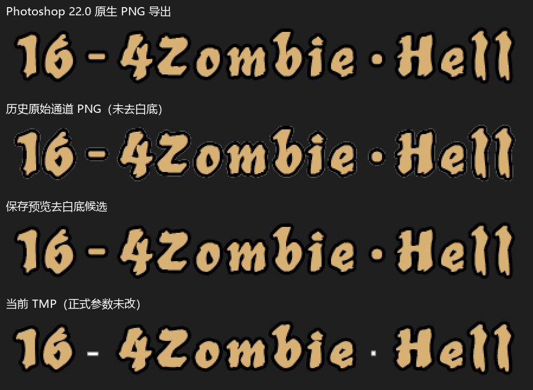
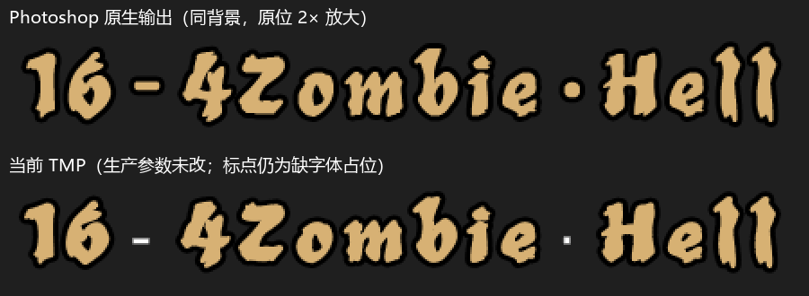
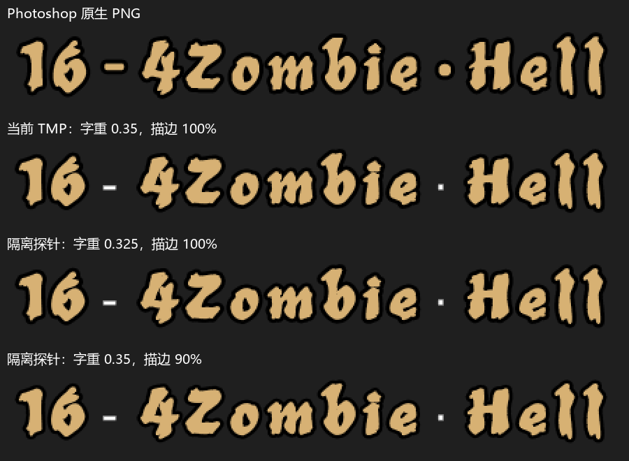

# PSD 文本对照：独立 Photoshop 基准（2026-11-16）

后续视觉对照使用 **Photoshop 原生导出的 PNG**。2026-11-14 仅凭通道分析、去白底公式和黑像素数量，就将历史图称为“错误基准、停用”，结论过早，现撤回该定性。边缘较浅与整体更接近用户观察到的原稿可以同时存在，不能用单个面积比例否定肉眼看到的偏胖。

本轮保留普通 TMP + 单字形 PSD 外描边及共享材质，没有修改生产三层、Shader、字重、描边或正式 Prefab，没有增加邻字组件；暂不实测移动端性能。

## 三份参考的来源

| 文件 | 来源与处理 | 当前用途 |
|---|---|---|
| `psd-saved-composite.png` | 历史读取器保留的 PSD 合成颜色及透明度通道，未去白底 | 保留原始证据，不覆盖、不作为普通 PNG 的自动转换目标 |
| `psd-saved-composite-unmatted.png` | 对上述通道执行白底反合成 | 保留为算法候选及历史探针对照，不视为 Photoshop 原生输出 |
| `photoshop-native-reference.png` | Photoshop 22.0 将当前文档复制为合并副本，通过 `PNGSaveOptions` 保存 PNG | 后续离线视觉对照默认基准，按原像素读取，不二次去白底 |

Photoshop 当前文档为项目中的 `Assets/Psd/战斗-主菜单界面.psd`：1080×2400、72 dpi、sRGB，导出前没有未保存修改。脚本只保存临时副本的 PNG，随后关闭副本并恢复原文档，未保存源 PSD。

另外使用保留图层的副本导出 `photoshop-native-layered-reference.png`。两条 Photoshop 导出路径得到的**全图 RGBA 逐像素完全一致**，因此本次观察到的差异不是先合并副本引起的。

原始证据：[合并副本 PNG](PsdTextAudit/StrokeDiagnosis/photoshop-native-reference.png)、[导出记录](PsdTextAudit/StrokeDiagnosis/photoshop-native-reference.json)、[保留图层 PNG](PsdTextAudit/StrokeDiagnosis/photoshop-native-layered-reference.png)、[对应记录](PsdTextAudit/StrokeDiagnosis/photoshop-native-layered-reference.json)。导出脚本为 `Tests/Editor/export_photoshop_reference.py`，只用于本机离线验证，不进入导入、预览或 Prefab 导出链路。

## 独立对照证实了什么

Photoshop 原生 PNG、历史原始通道 PNG、去白底候选的 Alpha 通道全图一致。在标题裁剪 `(320,90)-(765,155)` 内：

- 1498 个半透明像素，Photoshop 原生 PNG 与去白底候选的 RGB 完全一致。这给该区域的去白底处理提供了独立证据。
- 仍有 1464 个不透明像素，原生 PNG 与去白底候选的至少一个颜色通道差异大于 5，最大差值为 32。这些像素也区别于历史原始通道；去白底不改变不透明像素，因此无法解决此差异。
- 尚未定位这些不透明颜色差异的原因，不将候选图称为与 Photoshop 全等，也不根据“边缘更黑”推导整体更像原稿。



四行使用同一 PSD 坐标、相同深灰背景、相同整数倍放大；没有逐字平移或拉伸。既有 TMP 截图已经合成深灰背景，不能再将其当作透明图换成白底。缺失字体的标点仍使用固定占位，不纳入已有字体的视觉匹配结论。

## 当前 TMP 与探针



使用 Photoshop 原生 PNG 重新比较既有探针：

| Hell 局部指标 | 当前默认，字重 0.35 | 字重 0.325 探针 | 描边缩至 90% 探针 |
|---|---:|---:|---:|
| 近填充色像素数量／参考 | 1.023174 | 1.002107 | 1.023174 |
| 近黑描边像素数量／参考 | 0.957955 | 0.953009 | 0.842539 |
| 原位填充掩码 IoU | 0.774015 | 0.767514 | 0.774015 |

这些分别是固定阈值的像素数量比和原位掩码交并比，**不是整体还原率**。字重 0.325 的填充数量更接近参考，但原位轮廓重合反而下降；缩描边 10% 也没有消除填充轮廓差异。现有证据不支持把任一探针设为全部文字的新默认。



数据见 [原生基准下的既有探针](PsdTextAudit/StrokeDiagnosis/photoshop-existing-probes.json)。当前仍保留 WeightBold=0.35、FaceDilate=0、填充／外轮廓边缘=1、源 Tracking 与有界 advance 补偿。局部笔画、内部空隙、抗锯齿与遮挡差异仍需分别分析；未形成适配所有字体的公式，未宣称偏胖问题解决。

## 验证方式与本轮结果

离线读取的默认输入是原生 PNG。两个视觉检查命令支持显式 `--reference`，普通 PNG 原样读取；结果记录参考路径、SHA256 和处理方式。比较两侧使用相同背景并检查画布尺寸。最佳平移仅作位置诊断，使用零填充，不循环回卷边缘，不用于替代原位对照。

Python 全量 **19/19**、Unity 定向 `PsdTextAppearanceTests` **1/1** 通过。重新捕获的 `photoshop-current-tmp.png` 与历史 `appearance-base.png` 全图 RGBA 完全一致，确认本轮基准调整没有改变生产渲染。Unity Refresh 后编译状态正常、ShaderHasError=false，本轮 Console 检查起点之后无新增错误；两条 2026-11-14 的 `UnityConnect Token Exchange` 旧错误保留，没有清空 Console，也不报告为总错误数零。

源 PSD 与 `.meta` 的导出前后 SHA256 一致，分别为 `96b36bb03aa75bdbad9198be777c63abbd25a9d4792bbe1f51a0c1a0f3d2d128`、`c8f36fef1431002e81b321f93d22271c67676cc62cf707691d29f573fcd4c1e8`。

证据：[Python](PsdTextAudit/StrokeDiagnosis/photoshop-reference-python-tests.txt)、[Unity](PsdTextAudit/StrokeDiagnosis/photoshop-reference-unity-tests.json)、[原生基准与源哈希核验](PsdTextAudit/StrokeDiagnosis/photoshop-reference-verification.json)、[当前 TMP 捕获](PsdTextAudit/StrokeDiagnosis/photoshop-current-tmp.png)、[Energy Level 检查](PsdTextAudit/StrokeDiagnosis/photoshop-energy-check.jsonl)。

## 2026-11-14 历史结果的保留范围

当时使用的白底反合成公式为：

```text
存储颜色 C = 原前景色 F × A + 白色 × (1 − A)
F = (C + A − 1) / A，A > 0
A = 0 时颜色置零；透明度保持不变
```

该处理参考了 [psd-tools 的合成预览读取实现](https://github.com/psd-tools/psd-tools/blob/main/src/psd_tools/api/numpy_io.py)。已知夹具和实际 PSD 重解码的一致性验证的是公式与解析器行为，不能单独证明 Photoshop 的实际外观；独立原生导出是本轮补上的证据。公式只应用于特定保存预览的候选解释，不应用于普通 Photoshop PNG、Unity Sprite 或 TMP 截图。

历史 Hell 近黑像素数为：原始通道参考 1029、去白底候选 1179、当时 TMP 1162。因此得到 112.9% 和 98.6% 两种数量比；**98.6% 从来不能作为还原率，也不能据此否定用户观察到的偏胖**。历史三行图中的“旧错误基准／停用”标签不再代表当前结论。

2026-11-14 的 Python **13/13**、Unity **66/66** 通过，保留为当时的功能与回归记录，不冒充本轮测试结果或视觉通过证明：[Unity 原始记录](PsdTextAudit/StrokeDiagnosis/appearance-unity-tests.json)、[Python 原始记录](PsdTextAudit/StrokeDiagnosis/appearance-python-tests.txt)。历史 [去白底探针数据](PsdTextAudit/StrokeDiagnosis/appearance-probes-unmatted.json) 和文件名含 `invalid-white-matte` 的 [原始通道探针数据](PsdTextAudit/StrokeDiagnosis/appearance-probes-invalid-white-matte.json) 均保留出处；后者的旧文件名不代表已判定该图在所有视觉比较中无效。
