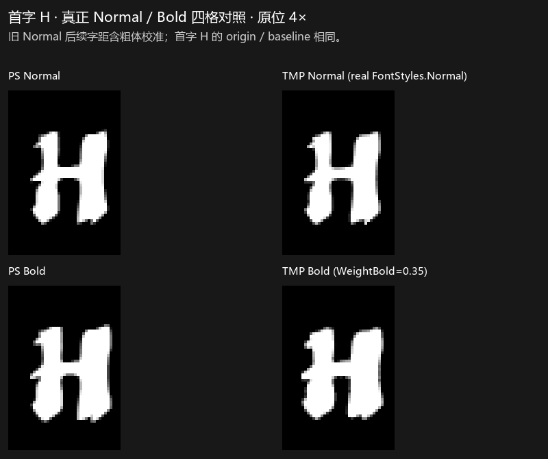
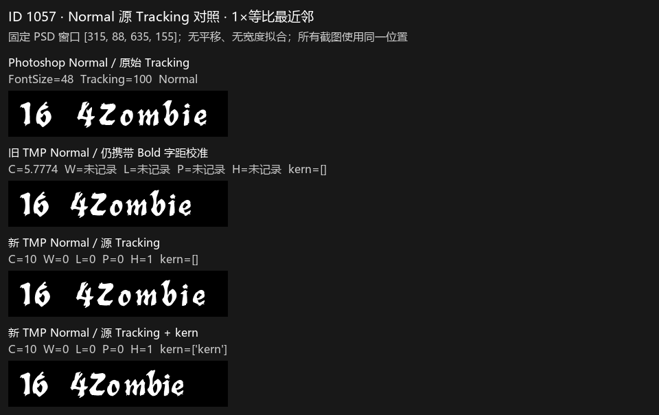
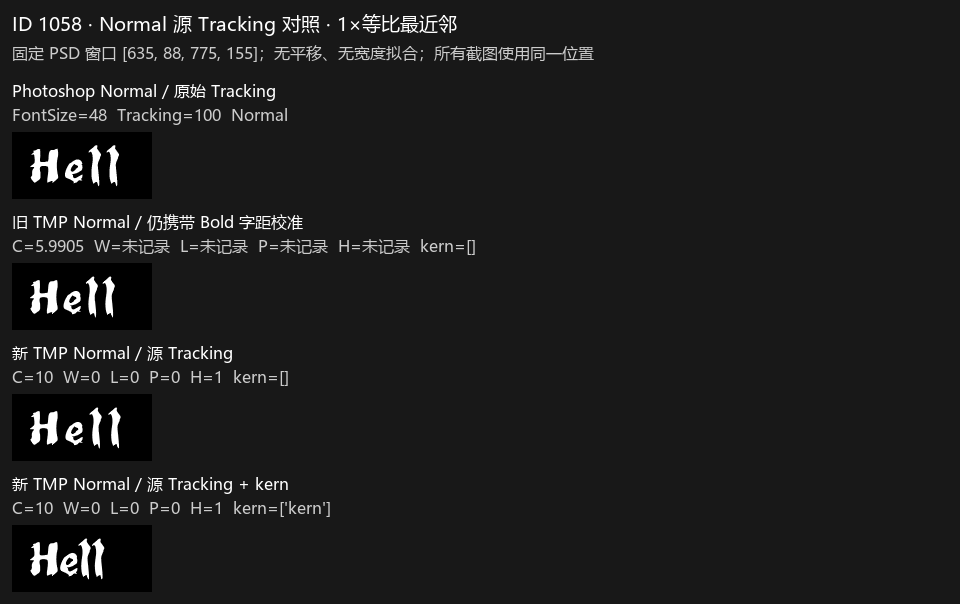

# TMP 局部偏胖：无描边字面验证（2026-11-16）

后续已将原型带回真实外描边并覆盖 13 个文本层，当前进度见 [字面与外描边联合验证](TMP_OUTLINE_BOLD_VERIFICATION.md)。下文保留无效果阶段的控制条件与结果。

本轮将文字填充、排版与描边分别验证。真正 `FontStyles.Normal` 的首字 `H` 已较接近 Photoshop，但这不能证明无效果整段文字基本一致。进一步移除旧 Bold 字距补偿、恢复源 Tracking 后，两个样本的整段原位排版明显改善，仍有局部约 1–4 像素的位置与边缘差异。本轮不宣称达到 98% 或基本完全一致。

**关闭图层效果不等于 Normal。** 原 PSD 的 TOXIA 文本启用了 `fauxBold=true`；即便关闭描边和阴影，其粗体字面仍与 TMP 存在差异。“普通首 H 较接近”是在两侧连模拟粗体也关闭的条件下成立，不能外推到原稿粗体。间距调整改善字符位置，不会修复单字内部的增粗分布。

后续优先独立校准 Character／Word，并为 Line／Paragraph 补充多行夹具；Horizontal Scale 保持 1，避免用横向压缩掩盖粗细差异。方向性增粗保留为冻结的实验候选，暂不作为主要推进方向；字重、描边及覆盖率曲线在基础排版稳定后再验证。

实验同时确认：**保留 `FontStyles.Bold`、仅把 Shader 字重设为零，并不等同真正的 `FontStyles.Normal`**。此前固定 Bold 排版的权重零探针保留为附加控制，不能用它代表普通字面或推导真实增粗强度。

本轮只增加 `Tests/Editor` 隔离探针、实验 Shader 和验证资料，没有修改 Core、Infrastructure、Presentation、正式 Shader、Prefab、字库或默认参数。方向性增粗实验在首 H 和标题上已有改善，但尚未完成全部文字与效果验证，不宣称偏胖已经解决，不做移动端性能实测。

## 对照条件

有效 Photoshop 对照为 ID 1057 的 `16  4Zombie  ` 与 ID 1058 的 `Hell`，源字号 48、Tracking 100。每次复制当前 PSD，按图层 ID 隔离目标，关闭目标及祖先效果，分别保存：

- `cached`：保留原有粗体字形缓存，只关闭效果。
- `normal`：使用当前 TOXIA 字体重新生成普通字重，关闭效果。
- `bold`：使用当前 TOXIA 字体重新生成模拟粗体，关闭效果。
- `rerender-effects`：重新生成模拟粗体并保留源效果，用于另行检查。

脚本检查字号、文字起点和 Tracking 没有意外变化。Photoshop 普通／粗体切换仍可能改变后续字符 advance；这不等于 Tracking 数值被修改。源文档只用于复制，临时副本用完关闭，不保存源 PSD。

TMP 从正式单字形共享材质 Prefab 创建隔离实例，只显示目标文字，黑底白字，关闭 Image、描边和阴影。默认探针保留 `FontStyles`、字号、字距、字符原点与 advance，仅切换 Shader 字重 `0`／`0.35`。因此 `w000` 是**保持粗体排版的零增粗渲染对照**，不是对整段普通字体排版的复刻；整段比较不单独用于判断基础字形是否一致。

首字 `H` 使用完整固定窗口 `(645,90)-(686,150)`，排除后续字符 advance 差异。两侧原点／基线一致，不逐字平移、不拉伸。最佳整数平移仅作为单独的位置诊断，采用零填充，未用于生成或验收对齐。

## 字体加载与来源

使用项目现有 `Assets/AAGame/UI/Fonts/Toxia_FRE.ttf`，内部名称 TOXIA Regular、版本 1.000，SHA256 为 `3d03ec037a0386e02f3f8bfa58e1639c1856fe497ab1137ce174ebbb74c60dc2`。正式 TMP Static 字库通过只读的 `m_SourceFontFileGUID` 确认指向同一项目字体，不靠名称猜测。

经用户明确授权，实验期间将该已有文件的绝对路径临时注册到当前用户的 `HKCU\Software\Microsoft\Windows NT\CurrentVersion\Fonts`，不复制、下载或改写字体文件。Photoshop 字体列表未立即刷新，实际新建文字及探针通过 `fontAvailable=true` 和 `fontPostScriptName=TOXIA` 确认字体可用；不能只凭列表未出现就判定实际渲染发生替换。

每轮脚本在 `finally` 中清理临时副本并撤销本次字体注册；最终只读检查确认临时注册不存在，源 PSD、`.meta` 和字体文件 SHA256 与实验基线一致。Photoshop 当前文档为未保存状态，实验不保存、关闭或恢复用户当前文档；实验 PNG 来自早先已验证的临时副本。见 [最终只读复核](PsdTextAudit/StrokeDiagnosis/fill-session-verification.json)。该临时授权仅服务本轮实验，不是工具导出时的自动字体安装能力。

## 首字 H 的结果

覆盖量分别取 Photoshop 透明 PNG 的 Alpha 总和，以及当前 Gamma 渲染路径下 TMP 黑底白字灰度总和，均除以 255。它是字面覆盖的诊断量，不是整体还原率。

| 首 H 指标 | Photoshop | TMP |
|---|---:|---:|
| 真正普通样式覆盖量 | 555.133 | 550.337 |
| 粗体字面覆盖量 | 666.667 | 673.396 |
| 正常到粗体的覆盖增量 | 111.533 | 123.059 |

真正 Normal 首 H 的原位掩码 IoU 为 `0.9232`，最佳整数位移为 `[0,0]`；50% 覆盖包围盒与 Photoshop 相同，均为 `[653,105,681,139]`。基础字形已较接近，但不能据此宣称所有字符或全部字号已还原。

真正正常→粗体的覆盖增量中，TMP 比 Photoshop 多约 10.3%；这是此样本的覆盖增量差异，不是整字胖了 10.3%，也不是还原率。50% 阈值下，Photoshop 粗体包围盒为 `[653,105,682,139]`，TMP 为 `[652,105,682,139]`：本例中 TMP 粗体还向左扩了一像素。TMP 切换 Bold 后另有少量局部覆盖减少，说明其效果并非单纯统一膨胀；不能据此反推出 Photoshop 的完整算法。

粗体对粗体的首 H 原位 IoU 为 `0.7986`。粗体 TMP 右移 1 像素的独立诊断值约 `0.8960`，说明位置／扩张分布会影响比较；这个平移没有写入正式资产，也不能替代原位验收。

附加控制中，固定 Bold 样式的权重零结果为 508.494；如果以它计算到权重 0.35 的增量，会得到 164.902，再与 Photoshop 比较便得到约 47.8%。**该比例使用了不等价的零点，已撤回作为真实增粗强度的解释。** 真正 Normal 与固定 Bold 权重零的首字符 origin／baseline 完全相同，但 quad 纵向范围不同：前者约 `92.42–151.74`，后者约 `94.67–149.49`。这正是需要检查样式、网格与图集采样关联的原因。

另一个核对结果：Photoshop `cached` 与重绘 `bold` 的**首 H 逐像素一致**。`Hell` 整段宽度从 97 变为 95 像素，主要体现后续字符位置变化，不能据此断言字体版本不同。原稿 Tracking 数值在两次导出中均为 100。

原始证据：[Hell 报告](PsdTextAudit/StrokeDiagnosis/fill-comparison-1058.json)、[完整对照图](PsdTextAudit/StrokeDiagnosis/fill-comparison-1058.png)、[标题报告](PsdTextAudit/StrokeDiagnosis/fill-comparison-1057.json)、[标题对照图](PsdTextAudit/StrokeDiagnosis/fill-comparison-1057.png)。报告已更新为 `formatVersion=2`，有效 A/B 使用真正 Normal；固定 Bold 权重零另列。每份输入保留 SHA256、覆盖来源、原位指标及平移诊断。

## 真正 Normal 的间距隔离验证

旧 Normal 探针只去掉了 Bold 样式，仍带着针对粗体的间距补偿：标题 1057 的 Character 为 `5.777372`，Hell 1058 为 `5.990467`。因此首 H 可以用于基础字形观察，后续字符的整段比较却不能直接解释为字体轮廓差异。旧报告未记录的 Word／Line／Paragraph／Horizontal Scale 不补写假定值。

新增 `CaptureSpacing` 与 `compare_psd_spacing_probe.py`，将以下五项作为明确记录的控制变量。使用同一正式字体图集、48 字号、真正 Normal、无描边／阴影，保持源文本及其空格；不平移、拉伸或按总宽度拟合。首字 origin／baseline 守卫通过。

| TMP 参数 | 当前受控基线 | 本轮验证范围 |
|---|---|---|
| Character | `源 Tracking / 10 = 10` | 源 Tracking 为 100；恢复此值后原位排版改善 |
| Word | `0` | 独立增加 1 的测试通过，逐个空格累计增加 advance |
| Line | `0` | 当前样本均单行，尚未验证行距对应关系 |
| Paragraph | `0` | 当前样本无多段落，尚未验证段距对应关系 |
| Character Horizontal Scale | `1` | 使用 TMP 真实公开属性，不用 Transform 或字号压缩替代 |

Character 与 Word 均增加 1 的隔离测试，在本轮 48 字号下产生对应的 `0.48` UI 单位 advance 增量；前者按字符累计，后者按空格累计，字形尺寸、字号、纵向位置和首字符原点不变。这确认了参数作用路径，没有证明 Word=0 已完整复刻 Photoshop 的所有空格规则。

| 对 Photoshop Normal 的原位 IoU@0.5 | 旧 Normal | 恢复源 Tracking | 源 Tracking＋kern |
|---|---:|---:|---:|
| 标题 1057 | 0.241071 | 0.514538 | 0.252254 |
| Hell 1058 | 0.568519 | 0.801834 | 0.407735 |

启用 `kern` 后这两个样本反而偏离参考，故当前 TOXIA 样本基线保持关闭；这不意味着所有字体都应关闭 kerning。表中数值是固定窗口的布局诊断，不是视觉还原百分比。Photoshop PNG 不提供可直接读取的逐字 origin，报告没有从轮廓反推并冒充 Photoshop 的原始字距数据。

最终人工复核使用 [同一窗口 2× 三行对照](PsdTextAudit/StrokeDiagnosis/fill-spacing-review.png)。其他证据：[标题参数及逐字记录](PsdTextAudit/StrokeDiagnosis/fill-spacing-comparison-1057.json)、[标题 4× 对照](PsdTextAudit/StrokeDiagnosis/fill-spacing-comparison-1057-4x.png)、[Hell 参数及逐字记录](PsdTextAudit/StrokeDiagnosis/fill-spacing-comparison-1058.json)、[Hell 4× 对照](PsdTextAudit/StrokeDiagnosis/fill-spacing-comparison-1058-4x.png)。本轮改善只在隔离探针中验证，尚未写入生产导出参数。

## 临时字库生成对照

为排查基础字形生成影响，另从同一源字体创建内存 TMP 字库，比较当前 96 采样 `SDFAA`、48 采样 `SDFAA` 和 48 采样 `SDFAA_HINTED`。字号和 Tracking 不变；替换字体后只允许按首个可见字符的 origin／baseline 做一次整段位置修正，并记录修正值。本轮候选该修正值均为零，未逐字调整。

| 首 H 对原生 Photoshop 的覆盖 L1 残差 | 固定 Bold 样式、权重零 | 粗体权重 0.35 |
|---|---:|---:|
| 当前 96／SDFAA | 88.53 | 156.11 |
| 48／SDFAA | 118.70 | 186.09 |
| 48／SDFAA_HINTED | 71.42 | 132.14 |

48 采样的 hinted 候选在该权重探针对照中有所改善，但其中权重零并不等同真正 Normal；仍有轮廓差异，且未覆盖全部字符、字号和抗锯齿模式。不能据此把正式字库统一改成该配置，也不能将残差下降换算成视觉还原百分比。

数据：[临时字库候选](PsdTextAudit/StrokeDiagnosis/fill-font-candidates.json)、[早期权重探针对照图](PsdTextAudit/StrokeDiagnosis/fill-font-candidates.png)。其中左列是固定 Bold 样式的权重零控制，不应用作真正 Normal 的视觉结论。临时 Font Asset、图集和材质只在内存中使用，结束后释放，不保存为正式资源。

## 验证与限制

### 方向性增粗隔离候选

在上述控制基础上，增加了独立实验 Shader `TextMeshPro/Mobile/Distance Field - PSD Outer Stroke - Directional Bold Probe`。它从正式外描边 Shader 复制，使用距离场一阶屏幕导数近似定向增粗，保持单 Pass、一次图集采样，不进行邻字合成，也不新增文字叠画或运行时组件。

探针要求临时字体的 mesh `boldStyle=0`、Shader 字重为 0，以固定基础网格和填充阈值，隔离方向性增粗项。当前 `X=1.5、Y=0` 是本轮截图条件下的屏幕像素候选值，不是 Photoshop 通用公式，也没有按每个字分别拟合参数。

| 目标与指标 | 当前正式字面 | 方向性候选 |
|---|---:|---:|
| 首 H 覆盖 L1 残差 | 156.11 | 53.25 |
| 首 H 原位 50% 掩码 IoU | 0.7986 | 0.9333 |
| 标题 1057 覆盖 L1 残差 | 739.13 | 414.66 |
| 标题 1057 原位 50% 掩码 IoU | 0.8189 | 0.8928 |

首 H 用于候选探索，标题用同一组参数交叉检查；这组结果支持继续研究定向增粗，而不是继续只做均匀收缩。标题的总覆盖量仍低于参考，其他字形、字号、方向和效果组合尚未完成验证。IoU 0.9333 不能称为“93.33% 视觉还原”。

证据：[首 H 候选数据](PsdTextAudit/StrokeDiagnosis/fill-directional-candidates.json)、[标题交叉检查](PsdTextAudit/StrokeDiagnosis/fill-title-directional-metrics.json)、[标题对照图](PsdTextAudit/StrokeDiagnosis/fill-title-directional-review.png)、[网格样式控制](PsdTextAudit/StrokeDiagnosis/fill-mesh-style-candidates.json)。当前正式导出仍使用原来的参数和 Shader。

### 测试与未覆盖项

新增 Unity `PsdTextFillProbeTests` **4/4 通过**：固定排版探针验证字重改变真实渲染、字符原点／advance 不变；临时字库探针验证首字符原点对齐及 Font 清理；方向性探针验证零值与基础 Shader 输出全等、非零值改变覆盖而不移动排版；间距探针验证 Character／Word 的独立增量且不缩放字形。测试同时检查源材质／Prefab 不变及临时场景恢复。见 [测试原始记录](PsdTextAudit/StrokeDiagnosis/fill-unity-tests.json)。

最终 Unity 检查 `compilationFailed=false`，正式外描边 Shader 与方向性实验 Shader 均为 `ShaderHasError=false`；Console 检查游标 507–519 之间没有新增 Error。该结论限于本轮检查区间，不表示清空或否认之前的 Console 记录。

ID 1091 的缩放文字尝试切换粗体时触发了“位置、字号或 Tracking 意外改变”的护栏，未纳入有效 A/B。后续若扩展该类节点，需要使用能保留源 transform 的操作并重新验证，不能放宽护栏后把结果混入本轮结论。

这些实验确认了两项需要分开处理的问题：粗体样式与 Shader 字重不是等价控制；去掉 Bold 后仍携带旧字距补偿会干扰整段判断。当前尚未提供生产修复。下一步先独立校准 Character／Word，再以多行、多段落夹具验证 Line／Paragraph，保持 Horizontal Scale=1；基础排版稳定后才重新验证粗体与效果。继续保留普通 TMP、单 Pass、共享材质及运行时改字能力，不恢复邻字组件，不引入多份文字叠画。
