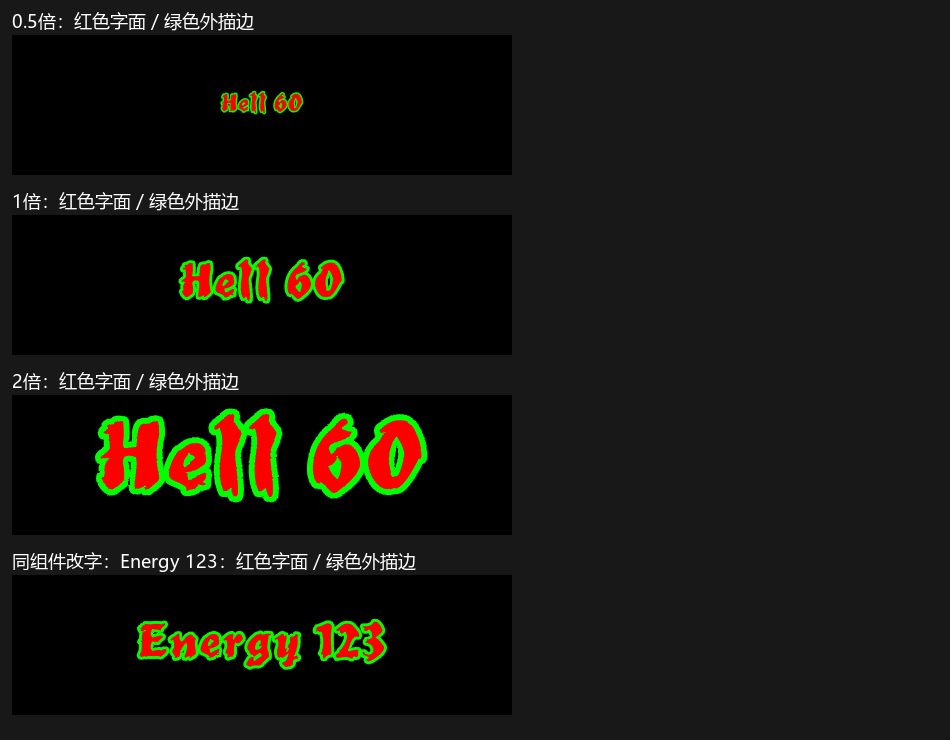
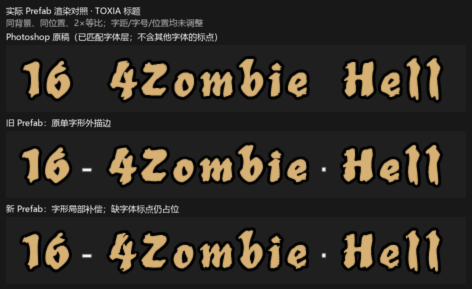

# 字形局部坐标扩张验证（2026-11-16）

实验 Shader 新增 `_PsdProbeGlyphSpace`，将扩张参数解释为图集像素。利用 UV 雅可比逆矩阵将屏幕距离场导数变换到字形图集坐标，再计算横向扩张。无需逐帧设置屏幕像素量，无新运行时组件、纹理或绘制 Pass。

当前 TOXIA 图集采样点 96，候选每 em 总横向扩张 0.03125，因此传入图集像素量为 `96 × 0.03125 = 3`，左右各分一半。字号和变换由现有 TMP 网格/UV 表达。旧屏幕坐标模式保留作为对照，未替换正式导出 Shader。

## 本轮变更

- 实验渲染：`Tests/Editor/Shaders/TMP_SDF-Mobile-PSDDirectionalBoldProbe.shader`，UV 退化时关闭导数转换，避免除零。
- 验证代码：新增 `PsdGlyphSpaceProbe.cs`、`PsdGlyphSpaceProbeTests.cs`；已有 `CaptureEffects` 支持字形坐标模式，记录模式和实际参数。
- 证据：`StrokeDiagnosis/glyph-space-*` 图片、指标和测试结果。

## 实际结果

以同一 TOXIA 字库、同一材质、48 字号、3px 参考描边，对比字形坐标参数固定为 3，与屏幕坐标参数按实际 UI 缩放调整的输出：

| UI Transform 缩放 | 最大 8 位通道差 | 结论 |
|---|---:|---|
| 0.5 | 3 | 等价程度满足边缘量化容差 |
| 1 | 4 | 等价程度满足边缘量化容差 |
| 2 | 7 | 等价程度满足边缘量化容差 |

三档中，可见区域每通道平均差均小于 1/255。不是逐像素全等，差异集中在距离场导数和抗锯齿边缘。新增三项真实渲染测试全部通过，且临时字体和 Preview Scene 数量恢复。

90°旋转后将截图旋回原方向，仅用于检查方向协变，字面及描边的 50% 掩码 IoU 分别为 0.9781、0.9610。它们不是 Photoshop 还原率；旋转后仍有像素网格采样差异。此项为离线截图验证，尚未建立全角度自动化测试。

同一 TMP 对象先显示 `Original`，再通过 `text.text` 改为 `Hell 60` 或 `Energy 123`，强制排版后字符数正确、材质引用不变，已生成真实截图。这验证了普通 TMP 改字路径，执行环境是 EditMode Preview Scene，不宣称已经在 Player 实测。

真实 PSD 的 Hell、0、Energy Level（48、50、34px）也接入了局部模式。与上一轮同强度的对称屏幕坐标候选相比，最大通道差为 3、2、3/255，原字符 origin、advance 和所有排版参数检查通过。

证据：[指标](PsdTextAudit/StrokeDiagnosis/glyph-space-metrics.json)、[新测试](PsdTextAudit/StrokeDiagnosis/glyph-space-tests.json)、[原探针回归](PsdTextAudit/StrokeDiagnosis/glyph-space-regression.json)。

## 尚未覆盖

本轮验证了均匀 UI Transform 缩放、一个直角旋转及普通 TMP 改字。未覆盖不同分辨率下 CanvasScaler 的完整组合、透视 Canvas、非均匀缩放、多图集回退、任意角度和 Player；未做移动端性能实测。真实字体仍仅 TOXIA。

## 可选导出接入（同日续验）

已接入菜单“导出 UGUI Prefab → PSD 外描边＋字形局部补偿（TOXIA，可选验证）”。API 模式为 `GlyphLocalBoldExperimental`，默认模式未变。新枚举使用值 3，保留退役模式值 2 为无效。新 Shader 名称为 `TextMeshPro/Mobile/Distance Field - PSD Outer Stroke - Glyph Local Bold`，仍基于官方 Mobile Distance Field 副本。

- Infrastructure：`PsdTmpGlyphLocalBold` 集中管理 TOXIA 校准和材质参数。只为此模式新建的 TOXIA 字库设置 `boldStyle=0`，保留 `boldSpacing=7`；其他字体仍使用已有外描边路径。
- Shader：将图集局部 X 导数用于对称横向扩张，图集宽度为采样字号 / 32，左右各一半。通过 TMP 顶点粗体标记控制，普通字重不扩张；`WeightBold=0`、`FaceDilate=0`。复用原 UI 裁剪和独立描边覆盖，无新增布局纹理、组件或 Pass。未覆盖的阴影等特性不因保留 Shader 代码就视为通过验收。
- Presentation：只新增可选菜单，Core、布局规划、字距规则和原默认入口未改变。导出字库仍是静态字库，包含源文本及该字体支持的 ASCII；正常改字不代表任意 Unicode 都有字形。

交付 [新 Prefab](<../Exports/战斗-主菜单界面_字形局部补偿.prefab>)：27 TMP、32 Image、14 个共享文字材质、6 个缺字体占位段。相同字体及最终样式继续共享材质，无 Workbench 运行时脚本。单独生成字体和材质，不修改旧 Prefab。

新增 3 项测试通过：正式 Shader 的粗体输出与探针对应，普通字重与无扩张探针对应；可选导出保留布局、字号、Character/Word/Line/Paragraph Spacing、缩放和自身显隐，确认旧 Prefab、旧字体/材质、PSD、meta 和显隐配置哈希不变，临时 Preview Scene 数量恢复。原 TMP 导出 3 项、填充探针 6 项、材质共享及退役接口 3 项回归通过，共 15 项。Unity C# 编译及新 Shader 错误检查通过，本轮无新增 Console 错误。

实际 Prefab 截图中，`Hell` 的 H 横竖笔画及 `4Zombie` 的部分曲线较旧导出收窄，更接近源字形，但仍有局部抗锯齿、轮廓和字形交界差异；不宣称已完全一致或达到固定还原百分比。原稿对照来自已校验 SHA256 的 Photoshop 缓存图片，未操作用户 Photoshop 文档；标题标点仍是缺字体占位。

证据：[新增测试](PsdTextAudit/StrokeDiagnosis/glyph-local-export-tests.json)、[导出回归](PsdTextAudit/StrokeDiagnosis/glyph-local-export-regression.json)、[填充回归](PsdTextAudit/StrokeDiagnosis/glyph-local-fill-regression.json)、[共享与接口回归](PsdTextAudit/StrokeDiagnosis/glyph-local-sharing-regression.json)、[整图截图](PsdTextAudit/StrokeDiagnosis/glyph-local-export-full.png)。本次没有移动端性能实测，也未执行 Player 验证。

## 后续细笔画修正

用户发现数字 `4` 顶部缺口后，已新增针对局部凹口的失败回归并修复。最新可选导出改为三次主图集采样及小额横纵联合补偿；旧材质默认仍走原导数路径。新的参数、8 项验证、13 层对照与成本变化见 [细笔画修正记录](TMP_THIN_STROKE_REPAIR.md)。以上一次采样数据属于修正前阶段。
