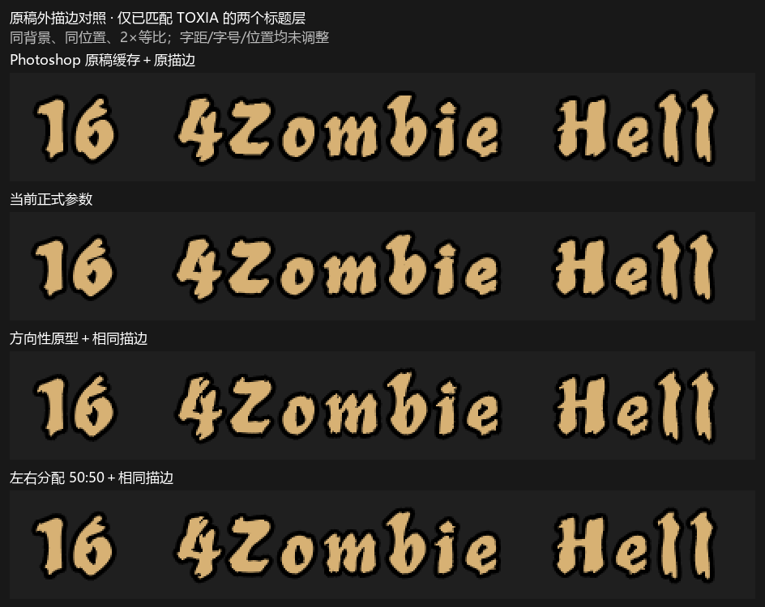

# 字面与外描边联合验证（2026-11-16）

后续已实现字形局部坐标版本，缩放与改字验证见 [后续记录](TMP_GLYPH_SPACE_VERIFICATION.md)。下文保留屏幕坐标实验的原始条件与限制。

本轮将粗体原型带回真实 PSD 的外描边，完成 13 个完整匹配 TOXIA 的文本层对照，覆盖 34、38、40、48、50px 字号及 2、3、5px 描边。

**当前正式外描边 Shader 在受控首 H 上没有因增加描边而膨胀字面。剩余偏胖已经存在于 TMP 模拟粗体阶段。** 去掉网格粗体 padding、改用独立横向扩张可以改善，但扩张的左右分配影响不同字符，不能只根据标题效果选择默认值。

## 变更范围

- 验证代码：`Tests/Editor/PsdTextFillProbe.cs` 增加 `CaptureEffects`；`PsdTextFillProbeTests.cs` 增加两组真实渲染测试。
- 实验 Shader：`Tests/Editor/Shaders/TMP_SDF-Mobile-PSDDirectionalBoldProbe.shader` 增加左右分配参数，仍基于 TMP Mobile Distance Field 的工作台副本。
- 参考与对照：`export_photoshop_effect_probe.py`、`compare_psd_effect_probe.py`、本说明及图片/JSON。

生产导出器、正式 Shader、字库、材质、Prefab、源 PSD 和 `.meta` 均未修改。没有新增运行时组件、邻字纹理或多份文字叠画；未测移动端性能。

## 参考条件

Photoshop 从当前磁盘 PSD 的临时副本读取，按源图层 ID 隔离目标，保留原缓存和原效果。不设置文字、字体、字号或模拟粗体，不重排字面，也不安装字体。当前用户文档可能有未保存编辑，不作为本次源文件，不保存或恢复它。

临时 PSD 位于 Unity 忽略的 `Tests/PhotoshopEffectProbe~`，导出后清理本次复制的文件和空目录。源 PSD/`.meta` 哈希、当前 Photoshop 文档 ID/数量/保存状态均经过前后检查。

这些文本实际只启用了 `FrFX` 外描边，没有启用投影，因此本轮不宣称完成阴影还原。ID 948 描边 Alpha=0.8，覆盖探针也保留 0.8；ID 1091 描边有深棕色分量，不按纯黑处理。

Unity 以正式 Prefab 的隔离实例渲染，固定字符 origin、advance、字号、Character/Word/Line/Paragraph、Horizontal Scale、kern 和位置。更换临时字库后不做位置补偿；任何排版变化都会中止。画布固定 1080×2400，缺字体占位段不参与评估。

## 描边是否改变字面

首 H 固定窗口 `(645,90)-(685,150)` 对比原描边与真正将 `_OutlineWidth` 设为 0 的结果：

| 路径 | 字面覆盖 L1 差 | 最大 8 位通道差 |
|---|---:|---:|
| 当前正式参数 | 0 | 0 |
| 单向扩张原型 | 0 | 0 |

外轮廓当然会随外描边增加，字面本身没有扩大。见 [描边/字面隔离记录](PsdTextAudit/StrokeDiagnosis/effects-outline-face-isolation.json)。

## 扩张分配对照

临时字库 `boldStyle=0`，材质 `_WeightBold=0`、`_FaceDilate=0`，保留 `FontStyles.Bold` 原排版。相同源字体、96 采样点、24 padding，不改正式字库。

参考画布下经验量为 `总横向扩张 = 1.5 × fontSize / 48`。左右分别为 `总量×(1-bias)`、`总量×bias`，Y 扩张为 0。片元使用一阶距离场导数近似：

```text
d' = d + max(0, -ddx(d) × 右扩张) + max(0, ddx(d) × 左扩张)
```

字面和外描边分别计算覆盖。仍为单 Pass、一次图集采样；这不代表已测得移动端收益。

| 左:右分配 | 字面与外轮廓原位 L1 均降低的层数 | 观察 |
|---|---:|---|
| 0:100 | 7/13 | 标题、Hell、60 等改善明显；部分单个数字向右偏 |
| 25:75 | 10/13 | 部分数字偏移减小，仍有反例 |
| 50:50 | 13/13 | 本组更稳妥，但标题改善幅度小于单向方案 |

“13/13”只表示本次两个诊断量比旧参数低，不表示完全一致、98% 还原或所有字体适用。这些层也用于探索参数，不是未见字体的独立泛化测试。



代表样本：[数字 0 的反例](PsdTextAudit/StrokeDiagnosis/effects-comparison-1090.png)、[背包](PsdTextAudit/StrokeDiagnosis/effects-comparison-979.png)、[Energy Level](PsdTextAudit/StrokeDiagnosis/effects-comparison-1091.png)、[13 层完整数据](PsdTextAudit/StrokeDiagnosis/effects-summary.json)。全部保持同背景、同位置、相同比例，没有对字符单独移动或拉伸。

## 指标与限制

Photoshop Alpha 直接作为有效外轮廓覆盖。字面覆盖由源填充色、描边色及 PNG 预乘 RGB 分离估算，仍包含色彩量化和抗锯齿差异。Unity 另渲染红字面/绿描边的同布局覆盖图，保持原透明度。L1、IoU 都不是视觉还原率。

当前方向参数仍按参考画布屏幕像素表示。接入正式导出前，需要让扩张跟随字形局部坐标和 Canvas 缩放，补充运行时改字、缩放和旋转验证。不能直接把像素参数全局发布，也不能按具体字符硬编码例外。

## 验证结果

`PsdTextFillProbeTests` 6/6 通过。新增两组覆盖首 H 和 Alpha=0.8 的数字：描边实际开关；原宽度和透明度保留；字面差异不超过一档 8 位采样；原点/advance/排版保持；源字库、共享材质、Prefab 不变，临时字体和 Preview Scene 数量恢复。

见 [测试原始记录](PsdTextAudit/StrokeDiagnosis/effects-unity-tests.json)。本轮编译成功，Console 序号 519 后无新增 error；不将历史错误计作本次新增。

下一阶段以对称横向扩张作为较保守的起点，单向分配保留为候选。先解决尺寸与坐标无关的 Shader 表达，再决定正式导出默认。本轮未替换生产参数。
