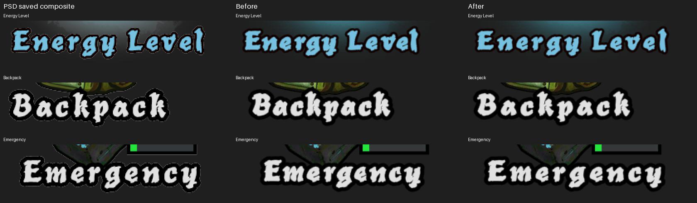

# 文本发胖：原稿对照与修复

**2026-11-16 基准更新：** 本文记录历史保存预览的诊断过程，不是当前视觉验收结论。此前仅凭去白底算法就将旧图定为错误并停用，证据不足。现已取得独立 Photoshop PNG；其标题半透明边缘与去白底候选一致，但不透明颜色并非完全一致。后续使用 [Photoshop 原生基准](PSD_REFERENCE_CORRECTION.md) 对照，旧图及功能测试保留，黑像素数量不能替代对局部轮廓和偏胖的判断。

此前只查看了导出整图，没有将原稿的文字局部并排核对，视觉结论不充分。自动测试通过也不能代替原稿对照。本次从同一 PSD 文件读取其保存的合成图，作为只读原稿参考；不是使用会忽略 Photoshop Effects 的官方 Sprite 代替最终效果。

修正版资产：`Exports/战斗-主菜单界面_TMP校正 1.prefab`。窗口后续导出默认使用修正版逻辑。既有 Prefab、字体与材质没有覆盖，源 PSD 和 `.meta` 保留。

## 实际截图

三列依次为 **PSD 保存的原稿合成图、原导出、修正后**，均按相同 PSD 坐标取样，以相同背景展示。截图像素做整数倍放大，未拉伸字形以匹配原稿。



[Energy Level 放大](PsdTextAudit/StrokeDiagnosis/final-energy.png)、[最终整图](PsdTextAudit/StrokeDiagnosis/final.png)、[保存的原稿](PsdTextAudit/StrokeDiagnosis/psd-saved-composite.png)。原稿反映文件最后保存时的合成结果，不代表 Photoshop 中尚未保存的修改。

## 分离变量后得到的原因

1. **TMP kern 让文本收窄。** Energy Level 的可见蓝色填充宽度由原稿 227 px 变为 207 px，窄约 8.8%；单位行宽里的蓝色填充像素多约 13.8%，产生拥挤、发胖的观感。只关闭 kern 后宽度回到 227 px，密度差异降为约 +4.3%。
2. **旧的伪粗体参数还略偏厚。** 仅修字距后，13 个已有字体样本的平均绝对填充密度差异约 8.68%，最差数字约 20.26%。统一比较 WeightBold=0.4／0.425／0.45／0.475 后，当前样本选择 0.425，平均降到约 4.74%，最差约 10.90%。这是当前 TOXIA 的样本参数，不是适配所有字体的 Photoshop 伪粗体公式。
3. **不能单独清零 Dilate。** 在 Outline 保持不变时清零 Dilate，会让居中描边侵入填充。本样本蓝色填充密度只剩原稿约 42.9%，明显过细。当前补偿公式保留，Dilate 仍与 Outline、RatioA 和基础字重一起计算。

修改后的 Energy Level 宽度为 227 px，填充密度约为原稿 97.9%。这是单个文字区域的指标，**不等于整图 97.9% 相似度**。SDF 抗锯齿、轮廓与小字号数字仍有差异，不宣称像素级还原或已经获得 98 分。

单变量证据：[七种组合](PsdTextAudit/StrokeDiagnosis/energy-variants.png)、[组合指标](PsdTextAudit/StrokeDiagnosis/variants.json)、[字重探针](PsdTextAudit/StrokeDiagnosis/weight-probes.json)。测试的指标是接近源填充色的像素数除以填充可见宽度；小字号和阈值会影响结果，必须与截图一起判断。

## 修改的模块

- **Core 文档／布局**：`PsdTextSource.ReferenceWidth` 保存源排版框宽度，传入不可变布局计划；仍保留源 AutoKerning 开关及逐段 Tracking，不改写源值。
- **Infrastructure 导入缓存**：从 TySh 的 `bounds` 读取点数宽度，按已验证的 72 DPI 与均匀变换换成 UI 单位；只在导入时读取。文本缓存格式升为 3，派生 Importer 扩展版本升为 4，触发旧缓存更新，不替换 Importer 身份。
- **Infrastructure TMP 构建／导出**：当全部字体可用时，比较保留源自动字偶距提示与关闭 TMP kern 两种方案的实际 advance，选择更接近源排版宽度的一种。改善需超过 0.5 UI 单位或源宽度 0.5%。只选择离散模式，不调 Tracking、不缩放字形、不逐层任意拟合参数。缺字体混排不拿原稿整行宽度强制拟合。导出诊断会显示调整数量；当前为 8 个文本层。
- **验证**：隔离场景内克隆材质做单变量截图，不修改已有资产。新增宽度回归先复现错误，再验证源宽度支持 kern 时仍保持开启，避免全部关闭字偶距。Python 局部检查可独立捕捉视觉密度问题。

Photoshop 的公开 API 使用 `AutoKernType` 表达字偶距选项，Tracking 则是独立的千分之一 em 间距；不能仅靠一个源布尔值宣称两套排版引擎等价。[Adobe CharacterStyle](https://developer.adobe.com/photoshop/uxp/2022/ps-reference/classes/characterstyle)

## 可复现检查

```powershell
python -B Assets/PsdUiWorkbench/Tests/Editor/check_energy_stroke.py Assets/PsdUiWorkbench/Documentation/PsdTextAudit/StrokeDiagnosis/final.png --all-known
```

Energy Level 检查要求行宽差异不超过 5%、填充密度差异不超过 8%。13 个已有字体样本要求平均绝对密度差异不超过 6%、最差不超过 15%。这是针对此次“发胖”的回归门槛，不是通用视觉评分。

原导出会在 Energy Level 检查失败；仅修字距的中间产物 `corrected.png` 会在 13 样本平均密度检查失败；最终产物两项均通过。新增 Unity 两个宽度用例验证“应关闭”和“应保留”kern，源 Tracking 不变。完整回归及最终 Console 状态记录在 VALIDATION.md。

最终完整回归 51/51、Python 审计 7/7 通过，编译成功且 Console 当前错误为 0。警告包含官方临时 PSD 的 `.` 图层名修正，以及测试运行期间生成的三张本次交付截图被 Test Runner 记为新增文件；截图有意保留作证据，不是未清理的临时场景或测试资源。历史 Console 缓冲未清空。

## 标题仍偏胖：再次反馈后的验证

用户再次提供标题局部截图。已通过 Unity 检查确认，其打开的是最新 TMP校正 1，WeightBold=0.425、Outline=FaceDilate=0.125、kern 关闭，不能归咎于打开旧版。此前平均密度阈值不足以检查字形内部空隙与局部轮廓，原“校正”不能视为完整视觉通过。

本次只增加 Tests/Editor 的分辨率探针，不改生产导出默认参数。比较标题字重 0.3／0.35／0.375／0.4，以及 SDF 采样 192／384（padding 同比例增加）。降低字重可以减轻厚重感；提高采样未明显恢复原稿轮廓。即使按平移对齐，Hell 填充掩码 IoU 仍约 0.87，减小字重没有实质消除形状差异。这不是整图相似率，不宣称已达到 98 分。

新增 `Exports/标题细字重验证.prefab`，仅两份 48 字号标题材质设为 WeightBold=0.375，其他文字仍 0.425，Outline/Dilate 和原稿 Tracking 保持；该资源为独立试验版，旧 Prefab 和材质没有覆盖。单独源字体、PSD、导入设置、配置没有修改。

[标题三行对照](PsdTextAudit/StrokeDiagnosis/title-review.png)：原稿／上轮 0.425／标题单独 0.375。另有 [字重对照](PsdTextAudit/StrokeDiagnosis/title-weight-comparison.png) 和 [采样对照](PsdTextAudit/StrokeDiagnosis/title-resolution-comparison.png)。所有分辨率探针的临时字体、Prefab 和场景已清理，只保留有意交付的截图和标题试验资产。验证结论：标题试验版略细，轮廓仍有可见差异；不能把这一轮标记为彻底解决。
