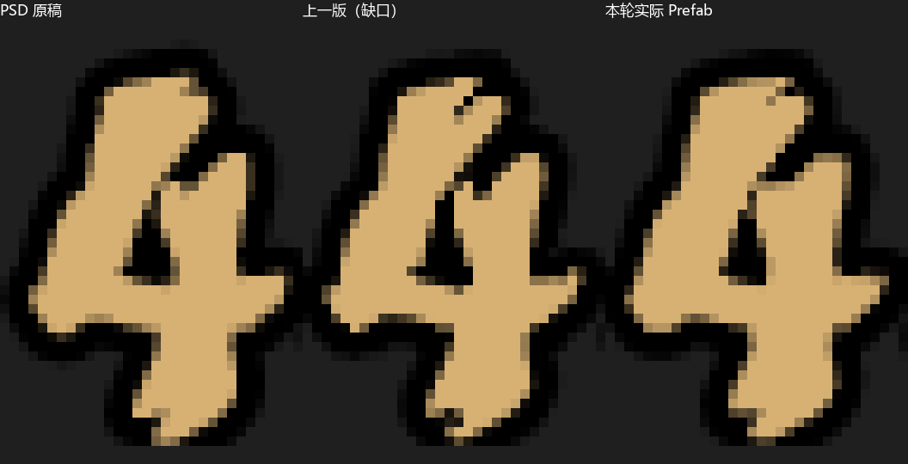
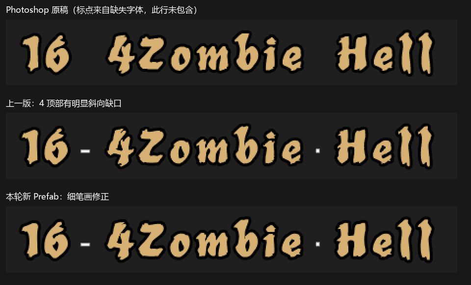

# TOXIA 顶部细线缺口修正（2026-11-16）

用户指出标题 `4` 顶部出现斜向裂缝。重新核对确认：这是局部深色凹口，并未把整个数字分成两个连通块。前一轮只检查主体连通性，未覆盖这种缺陷。

## 复现与定位

固定原 PSD 坐标 `(433,106)`、`(432,107)`、`(432,108)`，Photoshop 缓存中这三个像素的金色字面覆盖均为 1。上一版局部补偿输出为 `0、0.224、0.757`。`PsdThinStrokeTests.FourTopDiagonalDoesNotDevelopDarkNotch` 在未修复版本实测失败：第一个像素为 0，低于细线验收下限 0.65。该下限只用于这份固定原稿的回归，不是通用字体标准。

同一字号、字距、位置、字库及描边下比较：

| 方案 | 三个像素的字面覆盖 | 标题字面覆盖总量 |
|---|---|---:|
| 上一版单点导数、仅横向 | 0 / 0.224 / 0.757 | 3523.0 |
| 原横向＋0.2 图集像素纵向补偿 | 0.067 / 0.310 / 0.816 | 3582.2 |
| 三次直接采样、原横向量 | 0.286 / 0.784 / 0.827 | 3542.4 |
| 五次直接采样、原横向量 | 0.286 / 0.784 / 0.827 | 3544.6 |
| 最终：三次采样＋小额横纵联合补偿 | 0.675 / 1 / 1 | 3783.7 |
| Photoshop 原稿 | 1 / 1 / 1 | 3709.9 |

单点导数在尖角、窄凹口处不能可靠估算相邻字面；直接取左右距离场值的最大值，能在几乎不增加整体面积时明显改善缺口。剩余部分需要小额厚度补偿。五次采样对本例无明显收益，未保留到正式路径。没有提高字库分辨率：这证明当前字库可以改善该缺口，不代表采样精度对其他残差没有影响。

## 实现边界

- 渲染：继续使用 `TextMeshPro/Mobile/Distance Field - PSD Outer Stroke - Glyph Local Bold`。新增 `_PsdBoldSampling` 和 `_PsdBoldVerticalRadius`，默认均为 0，以保留旧材质表现。开启细线模式后，在原 UV 及左右偏移 UV 共采样三次；纵向使用局部 Y 导数的小额补偿。仍是单 Pass，不做邻字合成。
- 导出：`PsdTmpGlyphLocalBold.Configure` 仅为新导出的 TOXIA 可选模式启用细线设置。采样点为 `P` 时，总横向宽度为 `P × 3.5 / 96`，纵向每侧半径为 `P × 0.5 / 96` 图集像素；48 字号下分别对应总横向 1.75、纵向每侧 0.25 UI 单位。`WeightBold=0`、`FaceDilate=0`、独立字库 `boldStyle=0` 保持。
- 显示与架构：只处理 TMP Bold 字形，普通字重保持；没有改变字号、Character/Word/Line/Paragraph Spacing、横向缩放或布局规划。Core、旧插件及默认外描边导出未改动，无新增运行时组件、布局纹理或额外文字层。

新交付 [细笔画修正 Prefab](<../Exports/战斗-主菜单界面_细笔画修正.prefab>)：27 TMP、32 Image、14 个共享文字材质，6 个缺字体占位段。旧 Prefab/字体/材质未改写；旧局部模式材质因新属性默认 0 继续采用原来的导数路径。

## 实际验证

- 缺口回归由失败转为通过；开关描边的字面覆盖差受限于边缘量化容差，预览场景与临时材质数量恢复。
- 可选导出回归 3 项：普通字重、旧参数兼容、共享材质及布局/显隐和旧资产哈希检查。
- 原默认导出与退役接口回归 3 项。本轮合计 8 项通过；不是全项目测试数量。
- 实际新 Prefab 整图与审阅候选截图逐像素相同。
- 对照 13 个真实 TOXIA 文本层，12 个的字面＋外轮廓绝对差减少；ID 948 的小号 `4` 从约 84.4 增至 87.5，略有退步。若只看面积，部分小号数字仍偏厚，不能用汇总误差替代逐字视觉验收。
- Unity C# 编译和新 Shader 错误检查通过。验证过程中磁盘空间不足弹窗曾中断自动化，空间恢复后重新执行；没有清理用户的其他资产。

本轮没有移动端性能或 Player 实测。当前路径的主图集采样从一次变为三次，不能沿用上一版“一次采样”的成本描述；没有新增批次不代表 GPU 成本不变。参数仅针对当前 TOXIA 校准，不是所有字体公式，也不宣称完全消除原稿差异。

证据：[失败回归](PsdTextAudit/StrokeDiagnosis/four-notch-before-tests.json)、[修复回归](PsdTextAudit/StrokeDiagnosis/four-notch-after-tests.json)、[导出回归](PsdTextAudit/StrokeDiagnosis/four-export-regression.json)、[共享与默认回归](PsdTextAudit/StrokeDiagnosis/four-sharing-regression.json)、[13 层指标](PsdTextAudit/StrokeDiagnosis/four-final-metrics.json)、[实际整图](PsdTextAudit/StrokeDiagnosis/four-final-prefab-full.png)。覆盖数据通过保留原透明度的红色字面／绿色描边诊断渲染取得；不是还原率百分比。
