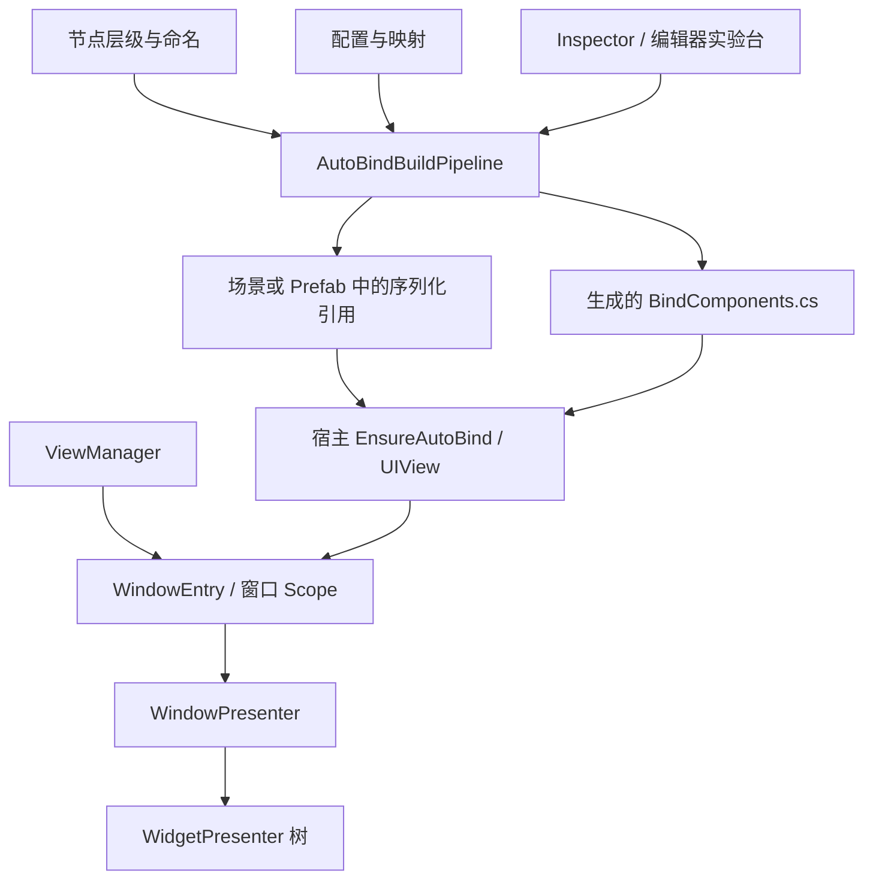
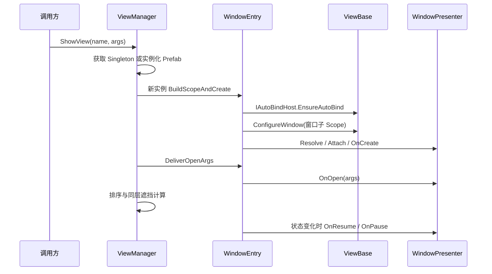

# ComponentAutoBindTool 新架构导读

面向首次接手工程的 AI 与开发者。本文描述当前实现，不是待实施方案。核对日期：2026-10-29；Unity 版本以项目根目录 `ProjectSettings/ProjectVersion.txt` 为准，当前为 **6000.3.20f1**。

本文中的 `Scripts/`、`Example/` 均相对于本文件所在的插件根目录。实际修改前，继续读取对应源码、项目根目录 `AGENTS.md` 和工作区未提交差异。

## 1. 先掌握这六件事

1. **编辑器生成，运行时取引用**：层级扫描、前缀解析、源码校验发生在编辑器；运行时把已序列化的组件引用组装成强类型 `UIView`。
2. **生成入口只有一条主流水线**：`AutoBindBuildPipeline` 负责准备、校验与提交；Inspector 和编辑器实验台是它的调用方。
3. **运行时核心是 ViewManager → WindowEntry → Presenter**：`ViewBase` 是宿主和注册入口，`WindowEntry` 持有窗口实例上下文与子 Scope，Presenter 承担逻辑。
4. **Widget 共享所属窗口 Scope**：嵌套 Widget 有独立 Presenter 和 UIView，但不会自动创建额外 DI 容器。
5. **关闭会话与销毁实例是两件事**：窗口可能缓存或等待延迟销毁；实例资源和每次打开的资源分别管理。
6. **示例是真实框架调用方**：五组运行实验和编辑器实验使用正式入口；观察服务没有另造窗口状态机。

### 按任务选择阅读入口

| 你要做什么 | 先读哪里 |
|---|---|
| 理解整体调用链 | 本文第 2～5 节 |
| 修改扫描、校验、生成或保存行为 | [AutoBindBuildPipeline.cs](Scripts/Core/Editor/AutoBindBuildPipeline.cs) → 第 3 节 |
| 接入一个普通业务窗口或 Widget | 第 4、5、8 节 → [迁移说明](MIGRATION.md) |
| 修改层级、导航、实例复用、关闭策略 | [ViewManager.cs](Scripts/ViewCore/Management/ViewManager.cs) 与 [WindowEntry.cs](Scripts/ViewCore/Management/WindowEntry.cs) |
| 调查 Widget 可见性、Tick、生命周期 | [WidgetPresenterBase.cs](Scripts/ViewCore/Presenters/WidgetPresenterBase.cs) → 第 5 节 |
| 理解或修改运行时实验台 | 第 6 节 → [实验操作说明](Example/README.md) |
| 理解或修改编辑器实验台 | 第 7 节 |
| 排查运行期窗口、过渡或排队 | 第 5.5～5.7 节 → 菜单“自动绑定UI组件 / 框架实验台 / 运行期窗口监控台” |
| 修改后验证 | 第 9 节 → [运行期增强验证](../../../Validation/ViewEnhancements/README.md) |

## 2. 分层、目录与依赖方向



| 目录 | 职责与约束 |
|---|---|
| `Scripts/Core/` | `ComponentAutoBindTool` 组件、运行时引用缓存及前缀映射。绑定引用层本身不负责窗口调度。 |
| `Scripts/Core/Editor/` | 扫描、源码契约检查、路径处理、确定性生成、序列化事务及 Inspector。 |
| `Scripts/ViewCore/Contracts/` | 新命名空间 `ComponentAutoBindTool.ViewCore` 下的宿主、管理器、上下文、Presenter 契约和策略枚举。 |
| `Scripts/ViewCore/ViewHosts/` | `ViewBase` 与 `WidgetViewBase`，供业务 partial 宿主继承。 |
| `Scripts/ViewCore/Management/` | `ViewManager` 负责调度，`WindowEntry` 负责单个实例与窗口子容器。 |
| `Scripts/ViewCore/Presenters/` | 窗口和 Widget 的生命周期基类、清理袋与受控 Tick。 |
| `Example/Scripts/*.BindComponents.cs` | 当前示例生成产物；默认跟随宿主脚本目录，文件必须与宿主处于同一程序集。 |
| `Example/Scripts/`、`Example/Editor/` | 运行实验台、编辑器实验台、重建与验证工具。示例逻辑全部留在 Example。 |
| `Example/Prefabs/`、`Example/Scenes/`、`Example/Fonts/` | 策略固定的窗口目录、场景、中文字体及离线资源。 |
| 项目根目录 `Assets/AATest/` | 测试沿用默认 Editor 程序集与 NUnit 引用；`Fixtures/AssemblyHosts` 单独验证自定义程序集宿主。 |
| 项目根目录 `Legacy/ComponentAutoBindTool/` | 旧框架源码与 `.meta` 归档，在 Assets 外，不参与 Unity 编译。 |

生成代码通过 `partial` 与手写宿主组成同一个类型；业务方法放在手写 partial 或 Presenter 中。运行时框架不依赖 Example，也不依赖编辑器流水线。VContainer 的注入与解析仍由容器实现，不能把“运行时不扫描绑定层级”理解成“整个应用没有反射或分配”。

三个框架程序集分别为 `ComponentAutoBindTool.Core`、`ComponentAutoBindTool.ViewCore`、`ComponentAutoBindTool.Editor`。依赖方向为 Editor → ViewCore → Core，Editor 同时直接引用 Core；运行时程序集不引用 Editor 或默认 `Assembly-CSharp`。Editor 仅支持 Editor 平台，引用 TMP、uGUI 与现有序列化字典。三个程序集保留 Auto Referenced，现有示例及业务脚本可继续使用默认程序集；Editor 通过 `InternalsVisibleTo("Assembly-CSharp-Editor")` 支持现有测试和实验入口。

`AutoBindKeyMapSetting` 的完整类型名已统一为 `ComponentAutoBindTool.Core.AutoBindKeyMapSetting`，但它属于 **Editor 程序集**；不要把它当作 Player 运行时配置。原脚本 GUID 与映射资产引用保留，旧源码中的 `Third_Party.ComponentAutoBindTool.Scripts.Core` 需更新。`DisplayOnly` 属性留在 Core，对应 Drawer 只在 Editor 中编译。

旧 [Core 架构分析](Scripts/Core/ARCHITECTURE.md) 是重构前的历史基线；理解当前行为应以本文、源码和测试为准。旧 `ViewLifetimeScope`、`ViewBundle` 等类型不再是接入入口。

## 3. 编辑器：绑定生成的完整闭环

核心入口：[AutoBindBuildPipeline.cs](Scripts/Core/Editor/AutoBindBuildPipeline.cs)。

```csharp
AutoBindBuildPipeline.RescanAndValidate(target, settings, keyMap);
AutoBindBuildPipeline.GenerateCode(target, settings, keyMap);
```

两个入口都返回 `AutoBindPipelineReport`：`Succeeded`、`ScanResult`、`ValidationResult`、`GeneratedFilePath`、`BindingsUpdated`、`CodeFileUpdated`。调用方根据报告显示结果；无 GUI 流水线本身不弹窗。

### 3.1 同一候选状态用于校验、保存和生成

1. [HierarchyScanner](Scripts/Core/Editor/AutoBindHierarchyScanner.cs) 从目标根节点的子层级按顺序扫描，返回候选绑定与扫描错误。每次生成都重扫，直接改节点名后点击生成即可。
2. [BuildInput](Scripts/Core/Editor/AutoBindBuildInput.cs) 根据目标宿主、脚本路径、配置与候选绑定准备输入；类名和命名空间以实际宿主类型为准。
3. [Validator](Scripts/Core/Editor/AutoBindValidator.cs) 和 [SourceInspector](Scripts/Core/Editor/AutoBindSourceInspector.cs) 检查宿主声明、真实成员冲突、可重写方法、字段名、引用归属、路径和输出程序集。
4. 有错误就返回失败，候选状态不写入组件、场景、Prefab 或生成文件。
5. 重扫校验成功时同步绑定和元数据，支持 Undo，但不生成代码，也不主动保存所属资产。
6. 生成成功路径先在内存中构造完整源码，再由提交事务更新对象与文件。

`AutoBindCodeGenerator` 只构造源码，不承担资产保存。这是编辑器入口触发的文本代码生成，不是 Roslyn Source Generator；SourceInspector 的声明检查也不能代替最终 C# 编译。新增生成入口应复用流水线，而不是另外串接“扫描 → 改组件 → 写文件”。

### 3.2 命名与扫描边界

| 输入或规则 | 当前行为 |
|---|---|
| `Btn_Close` | 根据 `Btn` 映射获取该节点组件，字段名转换为 `btnClose`。 |
| `TMTxt_Title` | 转换为 `tMTxtTitle`；沿用当前转换规则，不额外规范为 `tmpTitle`。 |
| `PrefixA_PrefixB_Suffix` | 多个前缀均指向当前节点上的组件；最后一段作为后缀。 |
| 嵌套根节点带 AutoBind | 父级可绑定该根节点，但停止进入其后代；后代由嵌套 AutoBind 自己扫描。 |
| 名称包含 `NonRoot ==>` | 跳过该节点及整个子树。运行时窗口挂载区用此方式排除在外层实验台扫描之外。 |
| 带 `TMP_SubMeshUI` | 跳过 TMP 自动生成的子节点及子树。 |
| 未知前缀、缺失组件 | 进入统一错误报告，阻止提交；不会静默丢弃该项后继续生成。 |

前缀来源于 [AutoBindKeyMapSetting](Scripts/Core/Editor/AutoBindKeyMapSetting.cs) 的内置映射与额外映射。`Widget` 内置映射到 `WidgetViewBase`，扫描器在节点上多态查找所有 Widget 派生组件；唯一组件直接绑定，同节点存在多个时使用该节点 AutoBind 的目标脚本消歧，若未指定有效的同节点 Widget 则报告错误并阻止提交。`Rtf_Widget_Item` 可同时绑定 RectTransform 与具体 Widget。生成的字段类型来自组件实例的实际派生类型，新增业务 Widget 不需要登记额外映射。

额外映射仍可用于自定义非 Widget 组件；默认映射优先于同名前缀的额外映射。右键新增记录使用完整类型名，历史短名仍受支持。映射配置 Inspector 会提示无法解析为 Component 的类型，并可通过“清理失效映射”删除这些记录，支持 Undo；清理前应检查迁移期尚未编译或已改名的类型。

### 3.3 三份绑定数据如何关联

| 数据 | 内容与使用方 |
|---|---|
| `BindDatas` | 编辑器期可读绑定记录，名称如 `Btn_Close`，附组件引用。 |
| `m_BindComs` | 按扫描顺序持久化的组件引用，运行时使用。 |
| `m_BindFieldNames` | 与组件列表对应的生成字段名，如 `btnClose`，运行时用于严格查找。 |

[SerializedBindingUtility](Scripts/Core/Editor/AutoBindSerializedBindingUtility.cs) 同步三份数据及宿主元数据。运行时组件反序列化后使字段索引缓存失效，首次查找时按需建立缓存；这里不会重扫 Transform 层级。

`GetBindComponent<T>(index, fieldName)` 以有效字段名定位，字段缺失、空白、引用失效或类型不符时记录错误并返回 `null`，不回退到旧索引上的另一个同类型组件。纯索引调用使用 `GetBindComponent<T>(index)`。

### 3.4 事务、路径与确定性产物

[GenerationTransaction](Scripts/Core/Editor/AutoBindGenerationTransaction.cs) 保存组件 JSON、所属资产文件、生成文件及必要的脏状态和 Prefab 覆盖快照。执行顺序为：检查可写与准备临时源码 → 同步绑定 → 必要时保存所属资产 → 提交代码 → 内容变化时导入该脚本。

- 普通场景及其 Prefab 实例保存为场景与实例覆盖；不自动 Apply 到源 Prefab。
- Prefab Stage 保存当前 Prefab；直接操作 Prefab 资产则保存该资产。
- 未命名场景生成时返回明确错误，要求先保存场景。
- 保存可能持久化所属场景中已有的其他编辑；这不是仅保存一个组件的操作。失败回滚恢复原文件，并保留操作前已经存在的内存编辑及脏状态。
- 可捕获的提交异常会尝试恢复本次修改；恢复错误也进入报告。没有进程崩溃或断电恢复承诺。
- 生成属于持久化提交，不单独提供组件 Undo；需要可撤销的扫描使用重扫入口。
- 源码相同时不改写代码、不改变其修改时间、不主动导入脚本；所属资产是否需要保存另行判断。

生成格式固定为 UTF-8 无 BOM、LF、四空格、无时间戳，类型使用 `global::` 完整限定名。内容变化时只 `ImportAsset` 目标脚本，不调用全局 `Refresh()`。

路径由 [PathUtility](Scripts/Core/Editor/AutoBindPathUtility.cs) 处理，必须在真实 Assets 边界内，且与宿主属于同一程序集。历史字段 `UseGlobalDefaultSavePath` 的实际语义是 **true 跟随脚本目录，false 使用配置目录**，现在新配置和项目配置均默认开启跟随。四份示例产物已迁移至宿主同级目录并保留 GUID。

配置输入采用广泛旧格式兼容：除项目 Assets 绝对前缀、盘符和 UNC 外，单斜杠路径按 Assets 相对路径解释；因此 `/Third Party/...` 和 `/tmp/Output` 都写入项目 Assets 内对应目录。配置只解释一次；边界检查与绝对路径转 Asset 路径不会再次套用兼容规则，所以 `Assets/../Outside` 和 `AssetsBackup` 仍被拒绝。文件夹选择器使用真实绝对路径检查，不能选择工程外目录。

Inspector 仅在显式切换目标脚本时同步类名、命名空间和路径，引用与元数据构成一次 Undo；清空引用会清空摘要。摘要同时只读反映当前配置。选择、重绘和配置变化不会隐式修改绑定数据；缺配置或解析失败不会留下部分更新的元数据。

## 4. 运行时：宿主、窗口实例与依赖注入

### 4.1 四个角色各负责什么

| 角色 | 实际职责 |
|---|---|
| `ViewBase` | 窗口 MonoBehaviour 宿主，持有层级、实例模式、遮挡、关闭策略；在 `ConfigureWindow` 注册 UIView、Presenter 和窗口服务。 |
| `WidgetViewBase` | Widget 宿主，提供生成绑定、UIView getter 与 GameObject 可见性入口。 |
| `WindowEntry` | 一个 `InstanceId` 对应的实例上下文：宿主、Canvas、状态、过渡、Presenter、窗口子 Scope。实现 `IWindowContext`，支持 `CloseSelf()` 与 `WaitClosedAsync()`。 |
| `ViewManager` | Prefab 获取、实例创建与复用、四层排序、导航、队列、计时和统一释放。业务调用优先经过 `IViewManager`。 |

`IAutoBindHost.EnsureAutoBind(GameObject)` 是生成绑定契约；`IUiViewComponent` 是生成 UIView 的标记接口。新接口全部位于 `ComponentAutoBindTool.ViewCore`。

`ViewBase`、`WidgetViewBase` 的绑定入口是虚方法。生成器按最近匹配基类声明决定 override，检查参数、返回类型、访问性、virtual 和 sealed，不能跨过一个隐藏或封闭的方法去重写更远祖先。普通 MonoBehaviour 也能生成公开方法并声明接口；已有显式接口实现的宿主按接口重新实现规则接入。

### 4.2 一次开窗的真实顺序



新实例才构建 Scope 和执行 `OnCreate`；缓存或已打开的 Singleton 重用现有对象。每次 ShowView 都交付新参数并执行 `OnOpen`，即使 InstanceId 和 UIView 没变。`OnOpen` 发生在本次调度刷新之前，不能假定此时 `Context.State` 已经是 `OpenAndActive`。

Entry 在交付 `OnOpen` 前已标记新打开会话，因此在此回调中调用 `Context.WaitClosedAsync()` 会等待本次关闭，缓存实例重开也相同。若用户在 `OnCreate` 释放管理器，或在 `OnOpen` / `OnResume` 关闭自身，调度器会重新检查有效性，释放未登记的准备实例，并避免发布过期的 `OnViewOpened`。

生成的 `EnsureAutoBind` 先构造临时 UIView，所有字段有效才写入宿主缓存 `view`；失败不会缓存残缺 UIView。`RegisterWindow` 拒绝空 UIView，Widget 的 `BindWidget` 也检查 getter 结果。生成的 Widget getter 可先完成绑定，再返回同一缓存对象；未生成时默认 getter 只提供明确诊断，不阻止骨架编译。

### 4.3 Scope 与注册寿命

下面是示例的实际容器关系；业务项目可以换组合入口，但窗口和 Widget 的所有权保持一致。

```text
AutoBindExampleScope：外层根容器
  ├─ LabTelemetry、LabResources
  └─ LabSession 的实验 Scope：重置时整体释放
       ├─ ViewManager：Scoped
       └─ 每个 WindowEntry 创建一个窗口 Scope
            ├─ IWindowContext、IViewManager、生成的 UIView
            ├─ AutoBindTestPresenter：Scoped
            ├─ LabScopeProbe：Scoped
            └─ Widget Presenter 树：从同一窗口 Scope Resolve
                 └─ Group → Left / Right，无额外 Widget Scope
```

示例在 [AutoBindTest.ConfigureWindow](Example/Scripts/AutoBindTest.cs) 中调用 `RegisterWindow<AutoBindTestPresenter, UIView>(builder, view)`；窗口服务按 Scoped 注册，Group 和叶 Widget Presenter 按 Transient 注册。

**同类型 Widget 同时绑定多个宿主时，Presenter 使用 Transient。** 若用 Scoped，多次 Resolve 会返回同一 Presenter，第二次 Attach 会覆盖第一份 UIView 和上下文。共享窗口服务应保持 Scoped，而不是给每个 Widget 新建容器。

框架通过 [IViewPrefabHelper](Scripts/ViewCore/Contracts/IViewPrefabHelper.cs) 与 [IViewRootHelper](Scripts/ViewCore/Contracts/IViewRootHelper.cs) 获取资源和层级根节点。默认实例释放是 Destroy；接对象池或其他资源系统时改对应适配器，不把特定加载库写进 ViewManager。

## 5. 调度与生命周期中需要保持的契约

### 5.1 窗口策略与公开行为

| 机制 | 当前含义 |
|---|---|
| `InstanceId` | 一个 ViewManager 内分配的实例标识；新实验容器重建管理器后会重新计数，不是跨容器全局 GUID。 |
| `Singleton` | 同一管理器中按 ViewName 复用打开、暂停、缓存或待销毁实例；A → B → A 会把旧 A 置顶并刷新参数。 |
| `Multiple` | 每次创建独立实例；使用 `CloseView(instanceId)` 精确关闭。 |
| 四层 | HUD / Normal / Top / System，各有独立打开顺序；根 Canvas 排序平移时保留子 Canvas 初始相对偏移。 |
| `Overlay` | 不因自身出现而暂停同层前窗。 |
| `PausePrevious` | 暂停并隐藏同层下方窗口；不自动暂停所有其他层。 |
| `TryNavigateBack()` | 按 System → Top → Normal 搜索允许返回的窗口；HUD 不参与返回。 |
| `immediately: false` | 按优先级 0 入队并立即返回 0；每次满足门禁的 Tick 最多处理一个请求。0 也用于打开失败，不能把它当成有效实例 ID。 |
| `EnqueueView(name, args, priority)` | 所有请求进入同一队列，优先级降序、同级先入先出。默认 Normal、Top、System 都没有打开窗口时出队；HUD 不阻塞。 |
| `BlockQueueWhenHigherLayersOpen` | ViewManager 默认 true；设为 false 时恢复只检查 Normal 层为空的规则。此门禁不改变各层的 PausePrevious 语义。 |
| `ClearWaitingQueue()` | 清空尚未打开的请求并归还请求池；不关闭现有窗口。 |
| `ReplaceTopView` | 目标 Prefab、宿主、窗口 Scope 与 OnCreate 准备成功后才关闭原栈顶；缺失资源时保留原窗。 |

替换的安全范围是目标准备阶段，不是对任意 `OnOpen`、事件订阅者异常都能回滚的通用事务。排序中的每窗步长和窗口数预算属于 ViewManager 的实现；超预算会警告，不是强制禁止继续创建。

### 5.2 关闭、缓存和销毁

| 阶段或策略 | 状态、对象与资源 |
|---|---|
| 新实例 | `Constructing` → 绑定、创建 Scope 与 Presenter → 打开调度。 |
| 有效运行 | `OpenAndActive`，执行受控 Tick。被同层遮挡后进入 `Paused`，保留打开会话。 |
| `NonDestroy` | 逻辑关闭后立即 `Cached` 并结束 OpenSession；退场完成后隐藏，保留 GameObject、UIView、Presenter 和窗口 Scope。 |
| `DestroyImmediate` | 逻辑关闭后立即 `Destroyed` 并移除 Singleton 索引；退场完成后清理实例与窗口 Scope，由 Prefab helper 释放 GameObject。无过渡时仍同步完成。 |
| `DestroyDelayed` | 逻辑关闭后 `PendingDestroy` 并开始真实时间倒计时；计时到期且退场完成后释放。实际释放前重开可复用 Singleton 会取消计时；实际释放后再开创建新实例。 |
| `Dispose` | WindowEntry 使用独立幂等标记，不以 `State == Destroyed` 推断资源已清理。 |

Presenter 基类提供两套资源袋与取消令牌：

| 寿命 | 清理时机 | 适合保存 |
|---|---|---|
| `AddToInstanceLifetime` / `DestroyToken` | `OnDestroy` 生命周期清理时 | 绑定到实例的订阅、按钮监听对应的解除动作、长期任务。 |
| `AddToOpenSession` / `OpenSessionToken` | 关闭时，或下一次 OnOpen 刷新上一会话时 | 本次打开的订阅、请求、临时任务。 |

按钮监听如果在 `OnCreate` 订阅，应在实例结束时解除；如果每次 `OnOpen` 订阅，应随 OpenSession 清理。不要仅因为 GameObject 暂时隐藏就释放整个窗口 Scope。

`CloseAllViews(true)` 会关闭并强制释放当前实例和缓存，不等待退场，但**不清空等待队列**；可另调 `ClearWaitingQueue()`。需要完整结束调度器时释放拥有 ViewManager 的 Scope；其 Dispose 同时处理队列、计时器、窗口及资源，即使部分回调抛错也继续其余清理，最后传播异常。

`WindowPresenterBase` 与 Widget 基类均保证活动会话先 Pause、再 Close、最后 Destroy；重复调用与生命周期回调重入不会重复清理。资源袋、取消回调或生命周期回调抛错时仍继续剩余清理。清理完成后抛出单个原异常或聚合异常，不静默吞错。

同一 Singleton 的 `OnClose` / 关闭清理尚未返回时，重入打开该实例返回 0，避免新旧会话在同一个 Presenter 上交叠。关闭回调返回后，即使退场仍未完成，也可以正常重开缓存或延迟销毁实例。等待 continuation 与 `OnViewClosed` 中重开属于后一种情况。

### 5.3 Widget：局部可见性与父级运行状态

窗口和 Widget 基类维护逻辑 Widget 树，由父 Presenter 级联生命周期。`BindWidget` 先确保宿主绑定，获取 UIView，从所属窗口 Scope 解析 Presenter，再 Attach 和 OnCreate。示例在 `OnCreate` 建立静态 Widget 树。

Widget 的有效运行状态为：**打开会话有效 && 父级已恢复 && 局部 IsVisible**。`SetVisible` 改变局部状态；父级 Resume/Pause 更新父级状态。只有有效运行状态真的改变时才触发一次 Resume/Pause，并继续传播给嵌套 Widget。

改变实际界面时使用 `presenter.SetVisible(visible, widgetHost)`，让逻辑状态与 GameObject 同步。单独调用 `GameObject.SetActive` 或 `WidgetViewBase.SetWidgetVisible` 不等于更新 Presenter 的逻辑可见性。

窗口的 `UnbindWidget` 从逻辑树移除整个 Widget 子树并执行销毁清理，不负责销毁宿主 GameObject；示例解绑后另行隐藏该宿主。缓存窗口重开不会自动重新执行 OnCreate 来重建已解绑的 Widget。

Widget 的销毁入口会先结束仍有效的打开会话：运行中的子树先 Pause，再 Close，最后 Destroy。已隐藏或暂停的不重复 Pause；未打开的不补 Close；正常关闭后销毁及重复销毁均不重复回调。生命周期回调、取消回调或 Disposable 抛错时继续尝试其余清理，最后传播异常。该保证位于 Widget 基类内，动态解绑和递归销毁共用它。

### 5.4 Tick 的唯一所有者

ViewManager 实现 `ITickable`，负责队列、活动窗口及 Widget 的受控更新、延迟销毁。窗口 Tick 传 `Time.deltaTime`；销毁计时使用 `Time.unscaledDeltaTime`。计时更新先缓存 ID，再改字典值，兼容 Unity Mono 的枚举器行为。

业务接入可以选择 VContainer EntryPoint 自动驱动，或由自己的 Update 调用 Tick，**同一个管理器二选一**。示例采用 `AutoBindExampleScope.Update → LabSession.Tick → ViewManager.Tick`；未再注册自动 Tick EntryPoint。`LabShellView.Update` 只处理 Safe Area、抽屉动画和低频观察文本，不重复驱动框架。

### 5.5 可选的入场与退场过渡

[IViewTransition](Scripts/ViewCore/Contracts/IViewTransition.cs) 定义 `PlayEnter(ViewBase, Action)`、`PlayExit(ViewBase, Action)` 和 `Cancel(ViewBase)`。在窗口根节点挂载实现该接口的组件即可接入；宿主首次查找后缓存结果，因此应在首次打开前完成装配。框架没有新增动画库依赖，也没有更改生成 UIView。

- 打开或恢复先切换逻辑状态、执行 Resume，再播放入场；入场期间根 GraphicRaycaster 关闭，完成后恢复。
- 关闭立即移出调度列表，执行 Pause / Close、取消 OpenSession 并恢复下方窗口。退场只延后隐藏与实例最终释放，不延后逻辑关闭。
- Entry 用递增版本过滤旧回调；退场中重开、过渡被取消、重复完成回调都不能隐藏新会话或重复释放实例。仅重算排序不会重播当前入场。
- 没有过渡组件或组件同步完成时，不额外等待一帧。管理器 Dispose、强制清理可直接取消过渡并释放。
- 过渡组件应在主线程调用完成回调，`Cancel` 应停止自身动画；正常播放必须最终通知完成。回调抛错会恢复可完成的框架状态并传播异常。

默认交互开关只覆盖**根 GraphicRaycaster**。若子 Canvas 配有独立 GraphicRaycaster，宿主应重写 `SetInteractable`，统一控制所需输入范围；不要把根开关解释为任意自定义输入系统的全局锁。

### 5.6 Unity Awaitable：等待逻辑关闭

`await manager.WaitViewClosedAsync(instanceId, token)` 与 `await Context.WaitClosedAsync(token)` 等待当前打开会话的**逻辑关闭**；不等待退场或延迟销毁。关闭钩子、OpenSession 清理与 `OnViewClosed` 完成后唤醒；管理器释放也会唤醒全部等待者。不存在、已关闭或管理器已释放时同步完成。

同一实例可有多个独立等待者，但每个返回的 Unity `Awaitable` 只能消费一次；多个调用方应各自调用 API，不能共享一个 Awaitable 重复 await。取消只取消该次等待，不关闭窗口，也不取消其他等待者。关闭流程出错依然结束等待，清理异常由关闭调用方接收。

[ViewCloseWaiters](Scripts/ViewCore/Management/ViewCloseWaiters.cs) 在用户关闭回调前分离旧会话批次，避免回调重开的新等待被旧关闭唤醒。完成源在内部 await 消费后才 Reset 并进入每个管理器的池；取消节点不复用，防止旧取消回调误操作新等待。调用管理器 API 需在 Unity 主线程；CancellationToken 可从后台触发，实际取消会切回主线程处理。该路径复用完成源，但不承诺整个异步 API 零分配。

### 5.7 运行期监控与诊断快照

[IViewManagerDiagnostics](Scripts/ViewCore/Contracts/IViewManagerDiagnostics.cs) 提供按层、非活动实例与等待队列的快照。调用方传入并复用 List；列表容量足够、路径预热后，填充快照不分配托管内存。快照包含实例 ID、状态、策略、排序、子 Canvas 数、剩余销毁时间、过渡状态、宿主，以及队列优先级和参数类型名。诊断查询不驱动 Tick、不反射私有字典、不修改窗口状态。

ViewManager 构造时注册到 `ViewManagerDebugRegistry`，Dispose 时注销。注册表按引用去重、排除已释放管理器，并在进入 Play 时清空静态残留，支持关闭 Domain Reload 的工作流；仍须按 Scope 生命周期正确释放管理器。

菜单 **自动绑定UI组件 / 框架实验台 / 运行期窗口监控台** 打开 UI Toolkit [ViewMonitorWindow](Scripts/Core/Editor/ViewMonitorWindow.cs)。它每 250 ms 刷新，复用行和快照列表，可切换管理器，查看四层、缓存/待销毁实例和队列，定位宿主、精确关闭、返回、关闭全部、强制释放及清空队列。编辑模式禁用运行操作，旧行按钮重新确认管理器和实例状态。无需场景 MonoBehaviour。Editor 文本格式化及界面刷新允许分配，不能将运行时快照的零分配结果推广为整个监控 UI 零 GC。

## 6. 运行时实验台如何组成

入口场景：[Example.unity](Example/Scenes/Example.unity)。布局是 uGUI + TextMeshPro，1280×720 参考分辨率，包含 Safe Area、五项实验导航、操作舞台、动作按钮和可展开观察抽屉。外层壳不属于受管理窗口，System 窗口出现时仍可操作导航和重置。

| 代码 | 作用 |
|---|---|
| [AutoBindExampleScope](Example/Scripts/AutoBindExampleScope.cs) | 注册观察与资源提供器，启动实验、连接界面，统一驱动 Tick，销毁时释放实验。 |
| [LabSession](Example/Scripts/LabSession.cs) | 实验动作到正式 IViewManager 调用的映射；Reset 先 Dispose 旧实验 Scope，再创建新 Scope。 |
| [LabShellView](Example/Scripts/LabShellView.cs) | 普通 MonoBehaviour + 自动生成 UIView；导航、按钮、Safe Area、抽屉显隐与约 10Hz 文本更新。 |
| [AutoBindTestPresenter](Example/Scripts/AutoBindTestPresenter.cs) | 共用窗口 Presenter，接收 LabOpenArgs，记录上下文与资源清理；Widgets 窗口绑定 Group。 |
| [LabWidgetGroupPresenter](Example/Scripts/LabWidgetGroupPresenter.cs) | 绑定两个叶 Widget，提供局部隐藏与请求父窗解绑的入口。 |
| [AutoBindExampleWidgetPresenter](Example/Scripts/AutoBindExampleWidgetPresenter.cs) | 每个叶 Widget 独立计数、按钮订阅和受控 Tick。 |
| [LabTelemetry / LabScopeProbe / LabResources](Example/Scripts/LabTelemetry.cs) | 真实生命周期记录、Scoped 依赖探针，以及固定 Prefab 目录与四层根节点适配器。 |

### 6.1 八个 Prefab 使用固定策略

下面对应 [AutoBindExampleSetup.Catalog](Example/Editor/AutoBindExampleSetup.cs)，避免在运行中随意改策略导致实验含义变化。

| Prefab 名 | 层级 | 实例 | 遮挡 | 关闭策略 |
|---|---|---|---|---|
| AutoBindTest | Normal | Singleton | Overlay | NonDestroy |
| Cover | Normal | Singleton | PausePrevious | NonDestroy |
| Multi | Normal | Multiple | Overlay | DestroyImmediate |
| Delayed | Normal | Singleton | Overlay | DestroyDelayed，3 秒 |
| HUD | HUD | Singleton | Overlay | NonDestroy，不参与返回 |
| Top | Top | Singleton | Overlay | DestroyImmediate |
| System | System | Singleton | Overlay | DestroyImmediate |
| Widgets | Normal | Singleton | Overlay | NonDestroy，启用 Group |

这些 Prefab 共用 AutoBindTest 的生成类型，因此保持相同绑定结构；非 Widgets 窗口中的 Group 为隐藏状态，结构和引用仍存在。Widgets 的两层结构为：窗口 → LabWidgetGroup → Left / Right 两个 AutoBindExampleWidget。

五组实验分别验证：层级遮挡；实例与参数；缓存/销毁；导航/替换/排队；Widget/DI。具体按钮步骤与预期现象集中维护在 [Example/README.md](Example/README.md)，本文不复制另一套操作手册。

### 6.2 观察、资源与重建

观察数据来自公开 `IWindowContext`、Presenter 回调、资源袋清理及 Scoped 服务 Dispose。UIView 身份用缓存对象的运行时标识展示，Tick 为实际回调次数；事件队列最多 200 条。没有反射框架私有字典。文本与 ScrollRect 容器复用，但当前实现会低频构造文本，不能把它宣称为全程零 GC。

`LabTelemetry` 保留跨重置的创建/释放计数；Reset 清除本轮窗口记录与事件。重置释放完整实验 Scope，因此可以检查窗口、排队请求和计时器是否残留。

中文使用 `Fonts/LabChinese.asset` 的静态预烘焙字形；Noto 原字体与 OFL 许可随 Example 保留，TMP Essentials 也在 Example 中。默认运行不依赖在线字体或远程资源服务；竖屏仅显示横屏提示。

菜单 **自动绑定UI组件 → 框架实验台 → 重建正式示例** 调用 AutoBindExampleSetup：重建示例场景、八个 Prefab、字体图集，经 Inspector 入口生成四个宿主的绑定。示例使用内置 Widget 前缀，不向全局额外映射写入业务类型；重建可能将已有根目录 TMP Essentials 移到 Example。重建会修改正式示例资产；这与本地实验重置的范围不同。已有场景、宿主与资产 `.meta` GUID 需要保留。

## 7. 编辑器绑定实验台

菜单 **自动绑定UI组件 → 框架实验台 → 编辑器绑定实验台**，入口 [PipelineLabWindow.cs](Example/Editor/PipelineLabWindow.cs)，样式 [PipelineLab.uss](Example/Editor/PipelineLab.uss)。四个区域是实验选择、目标层级与绑定表、源码差异、统一报告。

调用链为：`PipelineLabWindow → PipelineLabExperiment → ComponentAutoBindToolInspector.RunPipeline → AutoBindBuildPipeline`。Inspector 的内部入口支持关闭模态提示并传入配置覆盖，继续返回同一种报告。

| 部分 | 实际设计 |
|---|---|
| 实验资产 | 固定在 `Example/LocalPipelineLab/`，目录及 `.meta` 已忽略；使用专用 `PipelineLabHost`、临时场景与 Prefab。 |
| 配置 | 全局配置与映射的内存副本；实验覆盖输出路径，不改正式演示窗口或全局配置资产。 |
| 字段改名 | 专用宿主没有依赖生成字段的手写业务逻辑，改名后不会留下 Presenter 对旧字段的引用。 |
| 执行状态 | PipelineLabState 把实验编号、GlobalObjectId、报告、差异与文件时间等保存进 SessionState；这是当前编辑器会话恢复，不是跨机器的持久化项目配置。 |
| 写入时机 | 面板在编译、导入及 Play Mode 期间禁用写入；底层实验工具允许无 GUI 测试持有自己的重载锁。 |
| 回滚实验 | 场景保存回调短暂把实验代码设为只读；finally 解除回调并恢复原文件属性。报告比较真实组件、代码与资产快照，以及既有未保存编辑是否保留。 |

13 个实验涵盖首次生成、改名、嵌套 Widget/TMP 边界、五类失败校验、连续生成不改写、场景保存、Prefab 保存、实例覆盖和提交失败回滚。正式示例重建与本地实验重置是两个独立动作，不共用删除或清理范围。

## 8. 其他 AI 接手后如何扩展

### 新窗口或 Widget

1. 在业务目录创建可独立编译的 partial 宿主，窗口继承 ViewBase，Widget 继承 WidgetViewBase。窗口初始 ConfigureWindow 保持可编译，不先引用尚不存在的 UIView。
2. 创建层级或 Prefab，将目标宿主设到同节点 AutoBind 上；配置前缀和节点命名，确认嵌套根节点的边界。
3. 保存场景，使用 Inspector 生成；以成功报告、所属资产保存和脚本编译成功作为此步完成条件。
4. 在生成 UIView 已存在后接入强类型 Presenter；注册窗口服务与适合数量关系的 Widget Presenter 寿命。
5. 在组合入口提供 Prefab/root 适配器和唯一 Tick 驱动，设置策略；验证首次打开、刷新、关闭重开与释放。

### 修改已有行为

| 任务 | 首选修改位置 | 需要核对的结果 |
|---|---|---|
| 加组件前缀 | AutoBindKeyMapSetting 的映射配置 | 正确类型、嵌套边界、相应字段生成。 |
| 改字段转换 | AutoBindFieldNameUtility | 兼容已有字段，三份绑定与生成代码一致。 |
| 改校验或宿主契约 | Validator / SourceInspector / CodeGenerator | 拒绝非法输入且不提交，四类宿主生成后可编译。 |
| 改保存或回滚 | GenerationTransaction | 组件、代码、所属资产及既有编辑的失败恢复。 |
| 改导航、层级或销毁 | ViewManager / WindowEntry | 实例复用、精确关闭、队列、Scope 与计时释放。 |
| 改 Widget 生命周期 | 两种 Presenter 基类 | 两层嵌套、父级暂停、局部隐藏恢复、解绑。 |
| 改正式演示界面 | AutoBindExampleSetup + 宿主/Presenter | 重建、Inspector 生成、示例编译、跨比例交互。 |

硬约束：所有 `*.BindComponents.cs` 都通过工作流产生；更改绑定应改层级、映射或生成器后重新生成。更新文档里的示例代码不能代替真实生成。移动端热路径避免层级搜索与重复分配；示例专用探针留在 Example，通用调度快照属于 ViewCore，监控 EditorWindow 只在 Editor 程序集中。具体旧类型对应关系见项目根目录 [归档说明](../../../Legacy/ComponentAutoBindTool/README.md)。

## 9. 验证入口与已知边界

| 验证入口 | 覆盖内容 |
|---|---|
| [AutoBindPipelineTests](../../../Assets/AATest/Editor/AutoBindPipelineTests.cs) | 流水线、命名、路径、失败不提交、持久化回滚、严格字段查找和宿主契约。 |
| [WidgetLifecycleTests](../../../Assets/AATest/Editor/WidgetLifecycleTests.cs) | 局部隐藏恢复、动态解绑、嵌套 Pause/Close/Destroy 顺序、重复与重入保护、异常后资源释放。 |
| [AutoBindPathTests](../../../Assets/AATest/Editor/AutoBindPathTests.cs) | 真实项目路径入口及注入 Windows/Unix 根路径的规则测试，覆盖绝对边界、UNC、盘符、越界和二次解释。 |
| [AutoBindInspectorMetadataTests](../../../Assets/AATest/Editor/AutoBindInspectorMetadataTests.cs) | 显式选择和清空引用、Undo/Redo、配置失败不部分写入，以及只读摘要不修改绑定。 |
| [AutoBindAssemblyTests](../../../Assets/AATest/Editor/AutoBindAssemblyTests.cs) | 三个框架程序集依赖、配置迁移及独立宿主同程序集输出校验。 |
| [ViewCoreEnhancementTests](../../../Assets/AATest/Editor/ViewCoreEnhancementTests.cs) | 高层队列门禁、稳定优先级、动画与延迟销毁、开关回调重入及预热快照零分配。 |
| [ViewWaiterTests](../../../Assets/AATest/Editor/ViewWaiterTests.cs) | 多等待者、取消、完成源复用、会话隔离、晚消费返回值与后台取消切回主线程。 |
| [WindowPresenterLifecycleTests](../../../Assets/AATest/Editor/WindowPresenterLifecycleTests.cs) | WindowPresenter 嵌套生命周期、重复与重入、参数刷新和异常清理。 |
| [ViewMonitorWindowTests](../../../Assets/AATest/Editor/ViewMonitorWindowTests.cs) | 注册表、真实 UI Toolkit 操作、复用行、切换管理器和禁用 Domain Reload 的重入 Play。 |
| [AutoBindExamplePlayModeTests](../../../Assets/AATest/Editor/AutoBindExamplePlayModeTests.cs) | 实际场景开关复用与五组实验；每组连续运行、重置三轮。 |
| [PipelineLabTests](../../../Assets/AATest/Editor/PipelineLabTests.cs) | 编辑器实验真实入口、报告、无变化生成、失败回滚及实例覆盖重新加载。 |
| [AutoBindGeneratedCodeVerification](../../../Assets/AATest/Editor/AutoBindGeneratedCodeVerification.cs) | 两阶段生成并编译宿主，再验证接口调用与缓存；只在验证副本保留临时产物。 |
| [AutoBindAssemblyVerification](../../../Assets/AATest/Editor/AutoBindAssemblyVerification.cs) | 独立 asmdef 下四类宿主真实生成与编译、接口调用、Widget 缓存及实际 Player 脚本编译。 |
| [PipelineLabReloadValidation](Example/Editor/PipelineLabReloadValidation.cs) | 真实程序集重载后的目标、UI Toolkit 报告与重复生成检查。 |
| [LabCapture](Example/Editor/LabCapture.cs) | 实际 Unity 渲染、四种横屏比例、Safe Area、触控面积、射线、点击与滚动。 |

2026-10-29 在 Windows、Unity **6000.3.20f1** 验证副本执行的运行期增强套件结果为 **172/172**（原 129 项逐名核对保留，当时新增 43 项），见 [运行期增强验证](../../../Validation/ViewEnhancements/README.md)。当时四份生成文件内容及修改时间保持不变。此前的生成后重启编译、接口调用、独立程序集和真实脚本重载证据保存在 [129 项边界修复报告](../../../Validation/BoundaryFixes/README.md)；八张多分辨率截图和 51 项最初基线保存在 [Validation/FrameworkLab](../../../Validation/FrameworkLab/README.md)。Unix 路径是注入规则测试，尚未运行 macOS/Linux Unity。

2026-10-30 的 Widget 多态绑定迁移后，完整套件 **177/177** 通过；随后增加的完整类型名映射用例及其扫描测试 **4/4** 单独通过。八个示例 Prefab 和一个生成文件已通过 Inspector 流水线迁移，详见 [Widget 多态绑定验证](../../../Validation/WidgetPolymorphism/README.md)。

测试沿用现有 EditMode 程序集，其中通过 EnterPlayMode/ExitPlayMode 执行实际运行集成。`-runTests` 不与 `-quit` 同用；字体重建和截图需图形设备，不加 `-nographics`。普通测试可使用 `-nographics`。建议使用工程副本，避免测试切换场景影响正在编辑的场景。

目前需要保留的边界：生成事务不承担崩溃恢复；资源准备安全不等于所有 Presenter 用户回调都有事务恢复；动态在 OnOpen 内新增 Widget 的重入与重复回调需要单独测试；Prefab helper 是同步获取接口。编辑器模拟截图不替代移动真机性能验证。

框架修复的复现、根因与对应回归集中维护在 [Example/FRAMEWORK_FIXES.md](Example/FRAMEWORK_FIXES.md)。修改契约后同时更新本导读、相关操作说明与测试证据，避免其他 AI 从历史文档推断当前行为。
