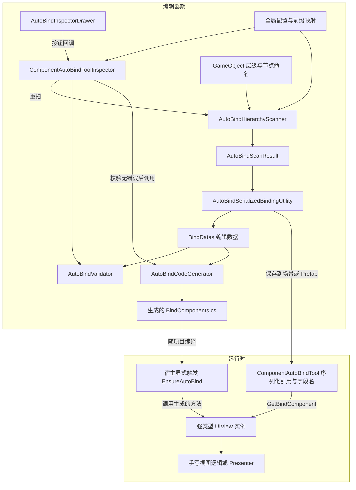

# ComponentAutoBindTool Core 架构设计分析

> **历史基线**：本文分析的是生成流水线迁移之前的工作区。当前的严格字段查找、统一报告、Widget getter、回滚及测试请以 [迁移说明](../../MIGRATION.md) 为准；下文保留用于理解本次重构动机。

> 分析日期：2026-10-28。依据当前工作区源码，包含尚未提交的修改，不代表某个历史发布版本。
>
> 分析范围：Core 目录内全部 20 个 C# 脚本；仅为说明接入关系，延伸阅读 ViewCore 的宿主、接口与绑定入口。
>
> 本文采用静态源码分析，并对 Windows 路径处理做了独立 .NET 行为核对；未在 Unity 中执行扫描、生成、编译或运行场景。文中的风险推导不等同于 Unity 运行回归结果。

## 1. 架构结论

这个工具采用**编辑器期预处理、生成代码与序列化引用协作、运行时按需初始化**的设计。

编辑器把节点命名转换成组件引用表和 C# 字段声明；运行时由宿主调用生成的 `EnsureAutoBind`，将引用表中的组件组装成强类型 `UIView`。节点遍历、命名解析和类型名称查询主要发生在编辑器期，业务通过 `UIView` 使用现成引用。

核心价值有三个：

- **提前解析**：把层级遍历与字符串形式的 `GetComponent` 移到编辑器工作流。
- **分离生成代码与业务**：通过 `partial class` 合并手写脚本和 `*.BindComponents.cs`，绑定结果不承担业务行为。
- **集中维护绑定关系**：扫描、命名转换、序列化同步、校验与生成各有独立模块，Inspector 负责串联流程。

它可以理解为一个小型的“绑定编译流水线”。这里的代码生成由 Inspector 主动触发，使用 `StringBuilder` 写文件；并非 Roslyn Source Generator。运行时绑定容器不直接依赖 VContainer，但生成器目前依赖 ViewCore 的接口。

当前最值得关注的架构问题是：**扫描诊断没有贯通到生成阶段、路径的存储格式与解析规则不统一、生成器与新 ViewCore 使用了不同的宿主接口**。这些问题见第 10 节。

## 2. 系统分层与依赖关系



这里有两种互相配合的产物：

| 产物 | 保存内容 | 作用 |
| --- | --- | --- |
| 场景 / Prefab 上的 `ComponentAutoBindTool` | 组件引用和字段名列表 | 保存实际对象关系 |
| `目标类名.BindComponents.cs` | 字段类型、字段名、索引和初始化方法 | 提供编译期类型约束与业务访问入口 |

生成代码本身不保存具体场景对象。**代码产物与序列化数据需要一起维护**：生成文件存在，并不代表对应 Prefab 的引用表已经更新。

### 2.1 编辑器与运行时的隔离方式

- [ComponentAutoBindTool][runtime] 的编辑数据、目标脚本和输出配置被 `#if UNITY_EDITOR` 包围；Player 保留引用表、字段名表和查找逻辑。
- `Editor/` 目录承载扫描、校验、生成和 Inspector；Core 下的 [AutoBindKeyMapSetting][keymap]、[ReadOnlyDrawer][readonly] 虽然不在 `Editor/` 内，也整体使用条件编译隔离。
- Core 未提供独立 `.asmdef`；当前主要依赖 Unity 的目录编译规则与条件编译，而不是独立程序集来表达模块隔离。
- VContainer 的容器创建和 Presenter 生命周期属于 ViewCore。Core 的运行时容器只负责绑定引用，不管理窗口栈、资源加载或业务生命周期。

## 3. 模块职责

### 3.1 运行时数据与编辑器配置

| 模块 | 主要职责 |
| --- | --- |
| [ComponentAutoBindTool][runtime] | 保存编辑数据和运行时数据；按索引或字段名获取组件；维护字段索引缓存；输出绑定错误 |
| [AutoBindKeyMapSetting][keymap] | 提供默认前缀映射和自定义映射，供扫描器解析组件类型名称 |
| [AutoBindGlobalSetting][global] | 保存默认命名空间、默认输出目录和路径跟随开关 |
| [AutoBindEditorAssetLocator][locator] | 按类型查找配置资源，并要求每种配置在项目中恰好一份 |

### 3.2 核心处理流水线

| 模块 | 主要职责 |
| --- | --- |
| [AutoBindHierarchyScanner][scanner] | 遍历子层级，解析节点命名，解析组件，收集绑定结果 |
| [AutoBindScanResult][scan-result] | 分别保存扫描成功项与扫描错误 |
| [AutoBindSerializedBindingUtility][serialized] | 通过 `SerializedProperty` 重建编辑列表，同步运行时列表，并检测两者是否一致 |
| [AutoBindFieldNameUtility][field] | 将绑定名转换为字段名，并进行基础标识符检查 |
| [AutoBindValidator][validator] | 校验目标脚本、输出路径、绑定名称和组件引用 |
| [AutoBindValidationResult][validation-result] | 聚合错误与警告，生成面向用户的报告 |
| [AutoBindCodeGenerator][generator] | 分析组件实际类型与宿主基类，构造 C# 源码并写入生成文件 |
| [AutoBindPathUtility][path] | 处理存储路径、脚本资源路径、绝对路径和 Assets 范围检查 |
| [AutoBindTargetScriptSyncUtility][target-sync] | 从目标 `MonoBehaviour` 同步类名、命名空间和输出路径 |

### 3.3 工作流入口与辅助界面

| 模块 | 主要职责 |
| --- | --- |
| [ComponentAutoBindToolInspector][inspector] | 调度扫描、数据同步、校验、生成与清空，负责日志和结果弹窗 |
| [AutoBindInspectorDrawer][drawer] | 绘制按钮、配置摘要、绑定列表和映射提示，通过回调把操作交给 Inspector |
| [AutoBindGlobalSettingInspector][global-inspector] | 编辑全局设置与输出目录 |
| [AutoBindKeyMapSettingEditor][keymap-editor] | 展示默认映射，编辑自定义映射字典 |
| [CustomContextMenu][context-menu] | 为 MonoBehaviour 提供挂载绑定工具和添加映射的右键入口 |
| [AutoBindKeyMapInputWizard][wizard] | 检查映射前缀和类型重复，写入并保存自定义映射 |
| [ReadOnlyDrawer / DisplayOnly][readonly] | 提供只读属性绘制，属于辅助功能，不参与绑定主链路 |

大部分处理模块是 `internal static`，数据结果类型是 `internal sealed`。这是同一编辑器程序集内的职责拆分；目前没有为每个步骤引入可替换的策略接口。

## 4. 数据模型与一致性约束

### 4.1 同一绑定的三种表达

以节点 `Btn_Start` 为例：

| 阶段 | 表达形式 | 示例 |
| --- | --- | --- |
| 编辑期 | `BindData(Name, BindCom)` | `("Btn_Start", Button 引用)` |
| 序列化运行数据 | 同索引的两个列表 | `m_BindComs[0] = Button`，`m_BindFieldNames[0] = "btnStart"` |
| 生成代码 | 强类型字段及初始化表达式 | `Button btnStart`，`GetBindComponent<Button>(0, nameof(UIView.btnStart))` |

`BindDatas` 是编辑器维护的源数据；`m_BindComs` 和 `m_BindFieldNames` 是其运行时投影。非序列化的 `Dictionary<string, int>` 又是字段名列表的派生缓存。

[同步工具][serialized]负责保证：

```text
BindDatas.Count == m_BindComs.Count == m_BindFieldNames.Count
m_BindComs[i] == BindDatas[i].BindCom
m_BindFieldNames[i] == BuildFieldName(BindDatas[i].Name)
```

这些约束主要由 Inspector 工作流维持。运行时容器没有逐项重新验证整个数据表；它在每次取值时检查索引、引用和类型。

### 4.2 字段名称规则

[BuildFieldName][field] 的实现是：删除全部 `_`，再将第一个 ASCII 大写字母改为小写。它不会把整个缩写统一改成小写。

| 绑定名 | 生成字段名 |
| --- | --- |
| `Btn_Start` | `btnStart` |
| `Img_PlayerAvatar` | `imgPlayerAvatar` |
| `TMTxt_Title` | `tMTxtTitle` |

生成器和序列化同步器共用该函数，这一点保证了生成字段与运行时名称表使用相同规则。不同原始名称仍可能生成相同字段，因此校验应针对转换后的名称，而不只检查原始名称。

### 4.3 缓存生命周期

字段索引字典在第一次按名称查询时创建；反序列化后，以及编辑器触发 `OnValidate` 后，会被清空并标记为需要重建。重复字段名构建字典时保留第一项。

正常访问先由编辑器阻止字段冲突。若绕过工作流直接修改公开的 `m_BindComs`，既可能破坏表间对应关系，也不会自动通知字段索引缓存失效。

## 5. 编辑器工作流

### 5.1 Inspector 初始化

[OnEnable][inspector] 获取序列化属性，并加载唯一的全局配置与映射配置；随后填充尚未设置的默认值，并检查运行时列表是否需要同步。

绘制设置区时，[目标脚本同步器][target-sync]从目标实例的类型和 `MonoScript` 资源路径更新类名、命名空间与输出路径。因此，目标脚本已经存在时，其真实类型会覆盖 Inspector 中的相关元数据。

### 5.2 “重扫校验”

```text
ApplySerializedChanges
  → CollectBindings
  → RebuildBindDatas
  → 同步运行时组件表和字段名表
  → ApplyModifiedProperties
  → 输出扫描错误
  → AutoBindValidator.Validate
  → 显示校验报告
```

重扫会清空并重建 `BindDatas`。手工修改的绑定名、组件引用或手工删除的条目，不会作为额外规则被保留。

扫描器返回的成功项即使伴随扫描错误，也会先写回列表。当前随后显示的校验报告只检查写回后的数据，不会合并 `AutoBindScanResult.Errors`，因此 Console 有扫描错误时，仍可能弹出“校验通过”。

### 5.3 “生成代码”

```text
ApplySerializedChanges
  → 校验当前 BindDatas 与目标配置
  → 有错误则终止；只有警告则继续
  → AutoBindCodeGenerator.Generate
  → AssetDatabase.Refresh
  → 提示生成完毕
```

**生成不会自动重扫层级。** 如果只是修改了节点名或层级，原有组件引用仍然有效，现有校验未必发现绑定数据已经过期。

`Generate` 方法本身负责构造和写入文件，不自行执行完整校验。校验与运行时列表同步的前置条件由调用方承担；以后增加批处理入口时，也必须处理这些前置条件。

“生成完毕”表示源码已写出并触发资源刷新，不代表 Unity 已完成后续编译。

### 5.4 手工编辑与“清空”

绑定列表允许手改名称和组件引用，也允许删除条目；发生序列化修改时，Inspector 会同步运行时列表。界面内的重复提示针对原始绑定名称，完整校验则针对最终生成字段名。

“清空”清除编辑列表及两张运行时列表，不删除已有 `*.BindComponents.cs`。清空后仍需要按实际意图重新扫描或生成，使代码与对象数据匹配。

## 6. 层级扫描与命名协议

### 6.1 遍历规则

[扫描器][scanner]按兄弟节点顺序执行深度优先遍历，起点是根节点的子节点；根节点自身不参与自动采集。

| 节点情况 | 是否尝试绑定当前节点 | 是否继续进入后代 |
| --- | --- | --- |
| 普通节点，名称包含 `_` | 是 | 是 |
| 普通节点，名称不含 `_` | 否 | 是 |
| 嵌套挂载 `ComponentAutoBindTool` | 是，仍需符合命名规则 | 否，由嵌套工具负责 |
| 名称包含 `NonRoot ==>` | 否 | 否 |
| 挂载 `TMP_SubMeshUI` | 否 | 否 |

遍历直接使用 `Transform.childCount / GetChild`，没有根据激活状态过滤，因此非激活子节点也会被扫描。

嵌套绑定根节点形成一个自然的职责接缝：父级可以拿到子控件宿主的引用，子控件内部的绑定交给自身维护。

### 6.2 多前缀解析

节点名按 `_` 分段，最后一段为字段后缀，其余每一段都视为组件前缀：

```text
Drop_Img_Quality
  → Drop + Quality → BindData("Drop_Quality", Dropdown)
  → Img  + Quality → BindData("Img_Quality", Image)
```

所以 `Btn_Login_Close` 表示 `Btn` 和 `Login` 两个前缀、`Close` 一个后缀；不会把 `Login_Close` 当成完整后缀。多词后缀可以使用 `Btn_LoginClose`。

映射查询先查默认字典，再查自定义字典；自定义映射不能覆盖已存在的默认前缀。前缀匹配区分大小写。扫描使用映射中的类型名称调用 `GetComponent(string)`，生成时则以组件实际的 `GetType()` 决定字段类型。

遇到未知前缀时，扫描器记录错误并停止处理当前节点剩余前缀；遇到缺少对应组件时，记录错误后继续处理后续前缀。此前已经收集的成功项不会回滚。

## 7. 校验、配置与输出策略

### 7.1 校验的覆盖范围

[AutoBindValidator][validator]把检查分为三组：

| 检查对象 | 阻止生成的错误 | 允许继续的警告 |
| --- | --- | --- |
| 目标脚本 | 未指定、未挂在同一 GameObject、类名或命名空间与真实类型不一致 | 无 |
| 输出路径 | 路径为空、Assets 范围检查失败 | 目录不存在，生成时创建 |
| 绑定数据 | 名称为空、转换后字段名非法或重复、引用为空、组件不在当前根层级内 | 没有绑定数据，生成空 UIView |

这里的“非法标识符”检查只涵盖 ASCII 字母、数字、下划线与首字符规则，并非完整的 C# 语义校验。例如手工绑定名 `Class` 会变为 `class`，当前字符检查可以通过，但生成字段会与 C# 关键字冲突。

校验也没有证明目标类已声明为 `partial`，没有验证生成文件与手写类处于同一程序集，没有检查输出文件冲突或所有宿主方法兼容条件。当前检查是工作流校验，不能替代编译器。

### 7.2 配置发现与扩展

[资源定位器][locator]通过 `AssetDatabase.FindAssets` 按类型发现配置，因此读取已有配置不依赖其固定目录；零份或多份配置都记录错误并返回空值。

映射资产包含常用 Unity、uGUI 和 TMP 类型，并通过 `GenericDictionary<string, string>` 存储自定义项。[映射向导][wizard]会阻止前缀重复，也会阻止类型名称字符串重复；该检查不能完全识别短类型名与全限定类型名实际指向同一类型的情况。

右键菜单当前以 `mono.GetType().Name` 填充类型名称，而不是 `FullName`。有命名空间或同名类型时，应关注字符串解析的歧义。

“按类型发现已有资源”与“创建资源”是两套行为：两个配置类的创建菜单仍固定写入插件目录下的 `.asset` 路径。移动插件后，已有配置的发现可以继续工作，新建配置的目录则仍需存在。

### 7.3 输出路径开关

| `UseGlobalDefaultSavePath` | Inspector 文案所表达的行为 | 最终路径来源 |
| --- | --- | --- |
| `false` | 使用统一默认目录 | 全局配置的 `CodePath` |
| `true` | 跟随目标脚本目录 | 目标对象保存的 `CodePath` |

属性名与实际语义容易混淆。当前配置资产中该值为 `false`，统一输出目录为 `Assets/Third Party/ComponentAutoBindTool/Scripts/ViewBindComponents`。

[路径模块][path]在“目标脚本目录”和“绝对目录”之间转换。当前存储格式经常带有前导 `/`，而解析时先调用 `Path.IsPathRooted`；Windows 上这两种约定存在冲突，见第 10 节。

## 8. 代码生成与运行时访问

### 8.1 生成代码的结构

[生成器][generator]读取当前 `BindDatas`，按列表顺序记录组件实际类型、字段名和原始索引；收集组件命名空间并排序去重，再生成以下结构：

```text
目标 public partial class
  ├─ [Serializable] public class UIView : IUiViewComponent
  │    └─ 每个绑定对应一个 public 强类型字段
  ├─ private UIView view
  └─ public [override] void EnsureAutoBind(GameObject go)
       ├─ view 已存在：直接返回
       ├─ go 为空：记录错误并返回
       ├─ 未找到 ComponentAutoBindTool：记录错误并返回
       └─ new UIView，并逐字段 GetBindComponent<T>(索引, nameof(...))
```

生成器沿基类链反射查找 `EnsureAutoBind(GameObject)`：如果找到可覆写虚方法，就生成 `override`；否则在目标 partial 类上增加它所引用的 `IAutoBindHost` 接口，并生成普通公有方法。

反射在编辑器生成时执行。运行时生成方法只在根对象上获取一次绑定工具，然后逐项读取缓存引用，不会重新扫描后代。

类型目前使用 `Type.Name`，并通过 `using` 引入命名空间；同名类型、嵌套类型和泛型类型的 C# 表达没有完整处理。生成文件名仅包含类名，同一输出目录中不同命名空间的同名类也会争用同一个文件。

文件每次通过 `File.WriteAllText` 覆写，并带当前时间注释；没有内容比较或确定性输出保证。手写逻辑应放在另一份 partial 文件中，生成文件应通过工具维护。

### 8.2 两种读取方式

| 调用 | 查找行为 |
| --- | --- |
| `GetBindComponent<T>(index)` | 直接使用传入索引；读取字段名仅用于错误说明 |
| `GetBindComponent<T>(index, fieldName)` | 优先查字段名字典；找不到名称时回退到传入索引 |

生成代码使用第二种方式。这使字段名和组件引用一起重排时，旧的生成索引仍有机会被名称查找纠正。

回退有明确限制：

- 名称存在但引用为空或类型错误时，直接记录错误并返回 `null`，不会再尝试旧索引。
- 名称不存在时，旧索引如果恰好指向另一个同类型组件，可能返回语义错误的引用；日志警告不能替代一致性保证。
- 删除或改名字段不会自动修复生成代码。工具只能在一定程度上容忍顺序变化。

### 8.3 初始化成本与失败行为

设绑定数为 B，参与遍历的节点数为 N：

| 阶段 | 主要成本 |
| --- | --- |
| 编辑器扫描 | 遍历约 O(N)，另加命名拆分、前缀查询及组件查询成本 |
| 序列化同步 | O(B)，重建两张列表 |
| 首次运行时绑定 | O(B) 建立字段索引字典，O(B) 填充 UIView；每项名称查询平均 O(1) |
| 后续业务访问 | 直接读取 UIView 字段，无需层级查找 |
| 重复调用 EnsureAutoBind | `view != null` 时快速返回 |

这个设计适合把移动端的查找成本集中到初始化阶段，但并非零分配：首次绑定创建字典、UIView 和相关存储，场景数据还保存字段名字符串。

当前 UIView 即使部分字段绑定失败，也会完成创建。之后 `EnsureAutoBind` 因 `view != null` 不再重试；没有统一的成功结果、失败回滚或重绑定入口。动态替换子节点时，需要另行定义引用更新策略。

## 9. 与 ViewCore / VContainer 的接入

### 9.1 职责划分

Core 负责回答“哪些对象绑定到哪些字段”；ViewCore 负责回答“何时绑定、何时创建容器、如何把 UIView 交给 Presenter”。

[ViewLifetimeScope][lifetime] 在 `Configure` 中调用宿主接口触发绑定，`RegisterCommon` 可注册生成的 UIView 和 Presenter。普通 MonoBehaviour 使用工具时，也需要手写生命周期入口或由外部主动调用 `EnsureAutoBind`，生成器不会自动增加 `Awake`。

新 [WindowEntry][window-entry] 的顺序是：调用宿主绑定 → 创建窗口子容器 → `ConfigureWindow` → 解析 Presenter。[ViewBase][view-base] 提供 UIView 与 Presenter 的注册辅助方法；[WidgetViewBase][widget-base] 则要求宿主提供 `GetGeneratedUIView()`，该方法目前不由 Core 生成器生成。

推荐保持的职责是：

- 生成层只声明组件字段并建立引用。
- 宿主负责触发绑定并暴露需要注册的数据。
- 容器接入层负责注册实例与生命周期。
- Presenter 消费强类型 UIView，承担界面行为。

### 9.2 当前接口并存问题

当前存在两个独立的同名接口：

| 接口全名 | 当前使用方 |
| --- | --- |
| `Third_Party.ComponentAutoBindTool.Scripts.ViewCore.IAutoBindHost` | Core 生成器在非 override 分支生成的接口；旧接口仍存在 |
| `ComponentAutoBindTool.ViewCore.IAutoBindHost` | ViewLifetimeScope、新 ViewBase、WidgetViewBase，以及新窗口 / 控件调用入口 |

两者没有继承关系，名称和方法签名相同也不意味着接口身份相同。

**静态推导**：对于继承新 `ViewBase` 或 `WidgetViewBase` 的目标类，基类使用显式接口实现，生成器按简单方法名查找时不会把它识别为可覆写方法；生成器随后给派生类增加旧接口实现。新调用方却转型为新接口，仍可能执行基类的空实现，导致生成的 UIView 没有初始化。

`ViewLifetimeScope` 保留了公有虚方法，生成器通常进入 override 分支，因此不能把上述故障直接推广到所有旧视图。

另外，当前示例中的 Presenter 注册与组件访问已被注释，原示例 `AutoBindTest.BindComponents.cs` 在工作区中已删除。本文据生成器说明产物形态，未把 README 中的旧代码当作已验证的运行样例。

## 10. 设计评价与改进优先级

### 10.1 已有设计的优势

- **运行时模块有足够的深度（Depth）**：调用方主要学习 `GetBindComponent`，即可使用集中封装的查找、缓存与诊断行为，避免重复维护这些规则。
- **规则具有局部性（Locality）**：字段命名规则在一处实现，扫描、序列化、校验和生成职责相对清晰。
- **嵌套根节点是有用的接缝（Seam）**：能将复杂界面分成各自维护绑定的子树，父级只持有必要宿主引用。
- **编辑期承担大部分解析成本**：绑定结果保存为对象引用，运行时业务不需要重复遍历 UI 层级。

从调用方视角，模块的接口（Interface）还包括隐藏在流程中的前置条件：配置唯一、目标脚本同根、目标类型可参与 partial 合并、生成文件与数据同步、宿主在使用 UIView 前主动绑定。仅看公开方法签名，会低估接入复杂度。

### 10.2 当前风险与建议

以下为后续工作建议，本次文档任务没有修改实现。

| 优先级 | 问题与触发条件 | 后果及建议 | 源码依据 |
| --- | --- | --- | --- |
| 高 | 生成器引用旧宿主接口，新视图通过新接口调用 | 新宿主可能执行空绑定。先统一接口身份，再验证窗口与 Widget 两条入口 | [生成器][generator]、[新宿主][view-base]、[窗口入口][window-entry] |
| 高 | 扫描失败仍写回成功项；扫描错误未并入校验；生成按钮不重扫 | 可能以不完整或过期数据生成代码。建立包含扫描诊断的统一处理结果，定义失败时保留或替换旧数据的规则 | [Inspector][inspector]、[扫描结果][scan-result]、[校验器][validator] |
| 高 | 跟随脚本目录时保存 `/Third Party/...`，解析时先判断是否 rooted | Windows .NET 核对中该路径解析为 `E:\Third Party\...`，而非项目 Assets。统一使用明确的 Assets 相对格式，并在一处转换为绝对路径 | [路径工具][path]、[目标同步][target-sync] |
| 中 | Assets 范围检查只用字符串 `StartsWith` | `.../AssetsBackup` 也能通过 `.../Assets` 前缀检查；应按目录分隔符或规范化相对路径检查 | [路径工具][path] |
| 中 | 校验缺少 C# 关键字、partial / 程序集兼容与输出冲突检查；生成类型使用短名 | “校验通过”后仍可能编译失败或覆盖别的生成文件。补充真实输入约束，使用可消歧的类型表达与输出命名策略 | [字段工具][field]、[校验器][validator]、[生成器][generator] |
| 中 | 名称查找失败后回退旧索引，且部分字段失败后 UIView 仍被缓存 | 同类型字段可能错绑，失败初始化不能重试。明确旧格式兼容策略，并返回可判断的初始化结果 | [运行时容器][runtime]、[生成器][generator] |
| 中 | 配置加载失败时 OnEnable 提前返回，但绘制阶段仍访问未初始化属性 | 配置缺失可能继续引发 Inspector 空引用。用明确的初始化状态与错误界面阻止后续操作 | [Inspector][inspector]、[配置定位器][locator] |
| 低 | 配置创建路径固定，映射向导保存短类型名，生成文件含时间戳并总是覆写 | 影响迁移、类型消歧和版本差异可读性。分别收敛资源创建策略、类型标识和确定性输出 | [全局配置][global]、[映射配置][keymap]、[右键菜单][context-menu]、[生成器][generator] |

### 10.3 演进顺序与验证方向

建议先解决接口一致性、路径规则和诊断贯通，再改进生成器的类型表达与产物稳定性。当前的静态工具拆分足以承载这些改动，不需要为每个工具类额外引入策略接口。

后续若增加批处理或 CI，可以把 `扫描 → 校验 → 序列化提交 → 生成` 的顺序与失败策略收敛为一个不依赖弹窗的入口；Inspector 仅负责展示和触发。同一入口可供人工操作和自动化验证使用。

建议覆盖的回归场景包括：

- 多前缀、未知前缀、缺少组件、非激活节点，以及嵌套绑定根节点。
- 原始绑定名不同但生成字段名相同、字段名为关键字、空列表和越界引用。
- 全局目录与跟随脚本目录、脚本直接位于 Assets 根目录、Assets 同名前缀目录。
- 普通 MonoBehaviour、ViewLifetimeScope、新 ViewBase 与 WidgetViewBase 的实际绑定调用。
- 重排后按名称取值、名称缺失后的索引回退、部分初始化失败，以及生成代码的编译检查。

本次在当前 Assets 中检索未发现 AutoBind 专用测试或工作流回归脚本，且 `Assets/AATest` 当前不存在；README 中的历史测试描述不能当作当前覆盖证据。

## 11. 源码阅读入口与分析依据

建议先读 [Inspector][inspector] 掌握调度，再读 [扫描器][scanner] 与 [序列化同步][serialized] 理解数据来源，接着读 [校验器][validator] 和 [生成器][generator]，最后对照 [运行时容器][runtime] 与 [ViewCore 接入][window-entry]。

本文链接定位到当前本机工作区源码。关键源码定位如下，后续代码变化可能使行号发生偏移：

| 关注点 | 定位 |
| --- | --- |
| 运行时两种读取方式、名称优先与索引回退 | `ComponentAutoBindTool.cs:63` |
| 字段索引缓存的延迟创建 | `ComponentAutoBindTool.cs:147` |
| Inspector 重扫、生成与扫描诊断处理 | `ComponentAutoBindToolInspector.cs:106`、`:178`、`:214` |
| 嵌套根节点与 TMP 子网格处理 | `AutoBindHierarchyScanner.cs:37` |
| 运行时两张列表的同步 | `AutoBindSerializedBindingUtility.cs:30` |
| 校验入口与绑定数据校验 | `AutoBindValidator.cs:12`、`:81` |
| partial 类与接口生成 | `AutoBindCodeGenerator.cs:88` |
| 基类 EnsureAutoBind 方法探测 | `AutoBindCodeGenerator.cs:180` |
| 路径范围检查与 rooted 分支 | `AutoBindPathUtility.cs:42`、`:92` |
| 新窗口调用绑定并创建子容器 | `WindowEntry.cs:53` |

环境依据为当前 `ProjectSettings/ProjectVersion.txt` 中的 Unity `6000.3.20f1`，以及 `Packages/manifest.json` 中的 VContainer `1.17.0`。这些信息描述当前工作区，未用 README 或 AGENTS 中的旧版本号替代。

[runtime]: <E:/Github Unity Projects/VContainer ComponentAutoBindTool/Assets/Third Party/ComponentAutoBindTool/Scripts/Core/ComponentAutoBindTool.cs:11>
[keymap]: <E:/Github Unity Projects/VContainer ComponentAutoBindTool/Assets/Third Party/ComponentAutoBindTool/Scripts/Core/AutoBindKeyMapSetting.cs:9>
[readonly]: <E:/Github Unity Projects/VContainer ComponentAutoBindTool/Assets/Third Party/ComponentAutoBindTool/Scripts/Core/ReadOnlyDrawer.cs:8>
[inspector]: <E:/Github Unity Projects/VContainer ComponentAutoBindTool/Assets/Third Party/ComponentAutoBindTool/Scripts/Core/Editor/ComponentAutoBindToolInspector.cs:10>
[drawer]: <E:/Github Unity Projects/VContainer ComponentAutoBindTool/Assets/Third Party/ComponentAutoBindTool/Scripts/Core/Editor/AutoBindInspectorDrawer.cs:9>
[scanner]: <E:/Github Unity Projects/VContainer ComponentAutoBindTool/Assets/Third Party/ComponentAutoBindTool/Scripts/Core/Editor/AutoBindHierarchyScanner.cs:9>
[scan-result]: <E:/Github Unity Projects/VContainer ComponentAutoBindTool/Assets/Third Party/ComponentAutoBindTool/Scripts/Core/Editor/AutoBindScanResult.cs:7>
[serialized]: <E:/Github Unity Projects/VContainer ComponentAutoBindTool/Assets/Third Party/ComponentAutoBindTool/Scripts/Core/Editor/AutoBindSerializedBindingUtility.cs:8>
[field]: <E:/Github Unity Projects/VContainer ComponentAutoBindTool/Assets/Third Party/ComponentAutoBindTool/Scripts/Core/Editor/AutoBindFieldNameUtility.cs:3>
[validator]: <E:/Github Unity Projects/VContainer ComponentAutoBindTool/Assets/Third Party/ComponentAutoBindTool/Scripts/Core/Editor/AutoBindValidator.cs:10>
[validation-result]: <E:/Github Unity Projects/VContainer ComponentAutoBindTool/Assets/Third Party/ComponentAutoBindTool/Scripts/Core/Editor/AutoBindValidationResult.cs:6>
[generator]: <E:/Github Unity Projects/VContainer ComponentAutoBindTool/Assets/Third Party/ComponentAutoBindTool/Scripts/Core/Editor/AutoBindCodeGenerator.cs:14>
[path]: <E:/Github Unity Projects/VContainer ComponentAutoBindTool/Assets/Third Party/ComponentAutoBindTool/Scripts/Core/Editor/AutoBindPathUtility.cs:8>
[target-sync]: <E:/Github Unity Projects/VContainer ComponentAutoBindTool/Assets/Third Party/ComponentAutoBindTool/Scripts/Core/Editor/AutoBindTargetScriptSyncUtility.cs:6>
[global]: <E:/Github Unity Projects/VContainer ComponentAutoBindTool/Assets/Third Party/ComponentAutoBindTool/Scripts/Core/Editor/AutoBindGlobalSetting.cs:9>
[global-inspector]: <E:/Github Unity Projects/VContainer ComponentAutoBindTool/Assets/Third Party/ComponentAutoBindTool/Scripts/Core/Editor/AutoBindGlobalSettingInspector.cs:7>
[locator]: <E:/Github Unity Projects/VContainer ComponentAutoBindTool/Assets/Third Party/ComponentAutoBindTool/Scripts/Core/Editor/AutoBindEditorAssetLocator.cs:6>
[keymap-editor]: <E:/Github Unity Projects/VContainer ComponentAutoBindTool/Assets/Third Party/ComponentAutoBindTool/Scripts/Core/Editor/AutoBindKeyMapSettingEditor.cs:8>
[context-menu]: <E:/Github Unity Projects/VContainer ComponentAutoBindTool/Assets/Third Party/ComponentAutoBindTool/Scripts/Core/Editor/CustomContextMenu.cs:8>
[wizard]: <E:/Github Unity Projects/VContainer ComponentAutoBindTool/Assets/Third Party/ComponentAutoBindTool/Scripts/Core/Editor/AutoBindKeyMapInputWizard.cs:8>
[lifetime]: <E:/Github Unity Projects/VContainer ComponentAutoBindTool/Assets/Third Party/ComponentAutoBindTool/Scripts/ViewCore/ViewLifetimeScope.cs:53>
[view-base]: <E:/Github Unity Projects/VContainer ComponentAutoBindTool/Assets/Third Party/ComponentAutoBindTool/Scripts/ViewCore/ViewHosts/ViewBase.cs:11>
[widget-base]: <E:/Github Unity Projects/VContainer ComponentAutoBindTool/Assets/Third Party/ComponentAutoBindTool/Scripts/ViewCore/ViewHosts/WidgetViewBase.cs:10>
[window-entry]: <E:/Github Unity Projects/VContainer ComponentAutoBindTool/Assets/Third Party/ComponentAutoBindTool/Scripts/ViewCore/Management/WindowEntry.cs:53>
